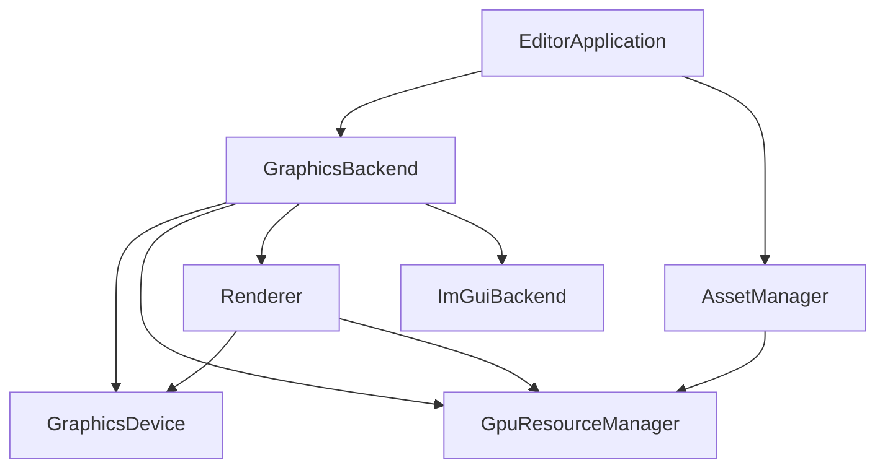

# Crimson Engine

Crimson is a small, data-driven real-time rendering engine written in modern C++ (C++23) with two interchangeable graphics backends: **Vulkan 1.3** (dynamic rendering) and **OpenGL 4.5** (SPIR-V shaders). It ships with **Crimson Editor**, a dockable ImGui-based editor used to inspect scenes, render targets and assets.

<p align="center">
  
</p>

## Features

- **Two backends, one API** - Vulkan and OpenGL implement the same `ResourceManager` / `Renderer` interfaces; application code never touches a native API type.
- **Handle-based resources** - buffers, textures, render targets, shaders and materials are referenced through opaque, generation-checked `Handle<Tag>` values instead of raw pointers.
- **Pass-based frame graph (lite)** - a frame is an ordered list of `RenderPass` (material draws) and `RawPass` (native interop, e.g. ImGui) entries stored in a fixed-size, allocation-free array.
- **Shader reflection** - material properties and texture bindings are discovered from SPIR-V with SPIRV-Reflect; shaders only declare what they use.
- **Lighting** - directional, point and spot lights in a single GPU light array (glTF `KHR_lights_punctual`-style), plus a shadow-mapped directional light.
- **Asset manager** - importer-based pipeline for textures, shaders, materials and meshes, with metadata and a scanned `assets/` directory.
- **ImGui docking editor** - viewport panels that display engine render targets, console, hierarchy, inspector, asset browser and performance panels, with a custom crimson-accented theme.

## Architecture



### GraphicsBackend

A single factory call creates the whole graphics subsystem and hands over ownership:

```cpp
auto backend = GraphicsBackend::Create(RendererAPIType::Vulkan, *window);
// backend->Device, ->GPUResources, ->Renderer, ->Imgui
```

Members are declared so that destruction order is correct (ImGui, renderer, resources, device). The renderer only holds references; it does not own the device or the resource manager.

### Resource management

- `Handle<Tag>` carries an index and a generation, so stale handles are detectable.
- `ResourceManagerBase<Traits>` provides the pools (`Register` / `Get` / `Unregister`); backend traits (`VulkanResourceTraits`, `OpenGLResourceTraits`) define the native types.
- Textures are first-class resources. A `RenderTarget` only references `TextureHandle`s, so any attachment can be sampled by a material or shown in the UI.
- Swapchain images are wrapped as non-owning textures.

### Frames and passes

```cpp
auto frame = renderer.BeginFrame(lighting);

auto& shadow = frame.BeginRenderPass({ .Target = shadowTarget, .ClearFlags = ClearFlags::Depth, .ViewProj = lightViewProj });
shadow.Draw({ vb, ib, material });

frame.AddRawPass(RawPassInfo{ .ClearFlags = ClearFlags::Color,
                              .Callback = [](const NativeFrameHandles& h) { /* ImGui, debug draw, ... */ } });

renderer.EndFrame(frame);
```

- `RenderPass` - draws described by vertex buffer, index buffer and material.
- `RawPass` - runs a callback with `NativeFrameHandles` (device, command buffer, color format) between engine-managed layout transitions. ImGui is rendered this way, so the engine itself has no UI concepts.
- Vulkan layout transitions and barriers are handled by the renderer; OpenGL needs none.
- Frame-in-flight synchronisation (fences, semaphores, per-frame UBO slots) is internal to the Vulkan renderer.

### Shader interface

Both backends share one binding convention. GLSL is compiled to SPIR-V with `glslc`; OpenGL consumes the same binaries (descriptor sets are normalised to set 0 before `glSpecializeShader`).

| Set | Binding | Resource | Scope |
|:---:|:-------:|:---------|:------|
| 0 | 0 | `CameraBlock` (dynamic UBO: `ViewProj`, camera position) | per pass |
| 0 | 1 | `LightingBlock` (UBO: ambient, shadow matrix, light array) | per frame |
| 0 | 2 | `u_ShadowMap` (sampler2D) | global |
| 1 | 3 | `MaterialBlock` (UBO) | per material, **optional** |
| 1 | 4+ | material textures | per material, **optional** |

Set 0 is fixed and identical for every shader. Set 1 is built from reflection, so a shader without material data (for example a depth-only shadow shader) needs no dummy block.

### Asset pipeline

`AssetManager` scans the `assets/` directory and dispatches files to registered importers:

| Importer | Produces |
|:---------|:---------|
| `TextureImporter` | `TextureHandle` |
| `ShaderImporter` | `ShaderHandle` (GLSL compiled to SPIR-V) |
| `MaterialImporter` | `MaterialHandle` (`.mat`) |
| `MeshImporter` | `Mesh` (vertex/index buffers + materials, e.g. `.obj`) |

Assets are addressed by path or `AssetID` (`FindByPath`, `GetAsset<T>`).

### Editor

Panels derive from `ui::Panel` and are owned by `ui::EditorUI`, which draws the dockspace and every panel inside a single raw pass:

- **Viewport** - displays a render target texture (scene, shadow map, ...).
- **Hierarchy / Inspector / Asset Browser / Console**
- **Performance** - FPS and frame time.

## Project layout

```
Crimson/
  engine/            core, renderer, backends (vulkan/, opengl/), asset manager
  editor/            Crimson Editor (application, panels, importers, assets/)
  external/          glfw, glad, glm, fmt, imgui, spirv-reflect, tiny-process-library
```

## Building

### Requirements

- C++23 compiler (GCC 13+, Clang 16+ or MSVC 19.35+); developed with MinGW on Windows
- CMake 3.20+
- [Vulkan SDK](https://vulkan.lunarg.com/) 1.3+ (headers, loader, **`glslc`** on `PATH`, validation layers)
- A GPU/driver with Vulkan 1.3 (dynamic rendering, synchronization2) and/or OpenGL 4.5 with `ARB_gl_spirv`

### Steps

```bash
git clone --recursive https://github.com/veresdomonkos/Crimson.git
cd Crimson
cmake -S . -B build -DCMAKE_BUILD_TYPE=Release
cmake --build build --target Editor
```

The `assets/` directory is copied next to the executable after every build. The graphics API is selected when the `EditorApplication` is constructed (see `main.cpp`).

> Use **Release** (or RelWithDebInfo) when measuring performance. Debug builds, especially with validation layers enabled, are many times slower and give misleading numbers.

## Editor controls

| Input | Action |
|:------|:-------|
| Right mouse (hold) | Look around |
| `W` `A` `S` `D` | Move |
| `Space` / `Left Ctrl` | Up / down |
| `Left Shift` | Move faster |

## Roadmap

- [ ] Built-in profiler: CPU scopes, GPU timestamp queries per pass, draw/bind statistics
- [ ] Per-pass material override (dedicated depth-only shadow material)
- [ ] State caching and draw sorting to reduce redundant pipeline/descriptor binds
- [ ] Viewport-driven render target resizing
- [ ] Per-object transforms (push constants on Vulkan, UBO on OpenGL)
- [ ] Multiple shadow-casting lights, cascaded shadow maps
- [ ] Shader hot-reload
