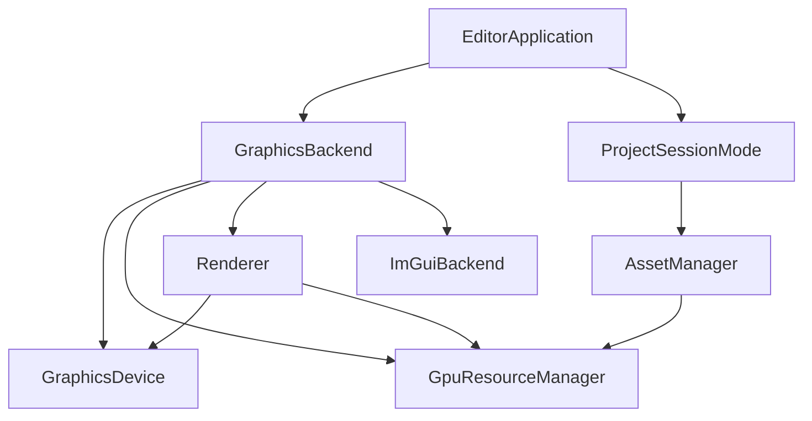

# Crimson Engine

Crimson is a small, data-driven real-time rendering engine written in modern C++ (C++23) with two interchangeable graphics backends: **Vulkan 1.3** (dynamic rendering) and **OpenGL 4.5**, both driven by the same HLSL shaders. It ships with **Crimson Editor**, a dockable ImGui-based editor used to inspect scenes, render targets and assets.

<p align="center">
  
</p>

## Features

- **Two backends, one API** - Vulkan and OpenGL implement the same `ResourceManager` / `Renderer` interfaces; application code never touches a native API type.
- **Handle-based resources** - buffers, textures, render targets, shaders and materials are referenced through opaque, generation-checked `Handle<Tag>` values instead of raw pointers.
- **Pass-based frame graph (lite)** - a frame is an ordered list of `RenderPass` (material draws) and `RawPass` (native interop, e.g. ImGui) entries stored in a fixed-size, allocation-free array.
- **HLSL shaders** - compiled in-process by glslang, which is linked statically, to SPIR-V. Vulkan uses the SPIR-V directly and SPIRV-Cross translates it to GLSL for OpenGL.
- **Standard blocks and reflection** - frame, view and material resources are grouped by how often they change. Material properties and textures are discovered with SPIRV-Reflect, and the standard blocks are checked against the engine's structs.
- **Lighting** - any number of directional, point and spot lights in a GPU buffer (glTF `KHR_lights_punctual`-style). Any light can cast shadows through a shared shadow atlas with PCF filtering.
- **HDR and PBR** - the scene renders in linear light to a floating-point target and is tone mapped for display, with metallic-roughness materials using the same slots as glTF.
- **Per-object transforms** - each draw indexes a per-frame buffer of object transforms.
- **Entity component system** - scenes are built on [EnTT](https://github.com/skypjack/entt) behind `Scene` and `Entity` wrappers, with a parent/child hierarchy.
- **Scenes as assets** - scenes are saved to `.scene` files, and any scene can be placed inside another as an instance.
- **Projects** - a project manager to create and open projects, each with its own `assets/` folder.
- **Asset manager** - importer-based pipeline for textures, shaders, materials and meshes, with metadata, scanning the open project and exposing the engine's own shaders and materials.
- **ImGui docking editor** - viewport panels that display engine render targets, console, hierarchy, inspector, asset browser and stats panels, with a custom crimson-accented theme.

## Architecture



### GraphicsBackend

A single factory call creates the whole graphics subsystem and hands over ownership:

```cpp
auto backend = GraphicsBackend::Create(RendererAPIType::Vulkan, *window);
// backend->Device, ->GPUResources, ->Renderer, ->Imgui
```

Members are declared so that destruction order is correct (ImGui, renderer, resources, device). The renderer only holds references; it does not own the device or the resource manager.

### Resource management

- `Handle<Tag>` carries an index and a generation, so stale handles are detectable.
- `ResourceManagerBase<Traits>` provides the pools (`Register` / `Get` / `Unregister`); backend traits (`VulkanResourceTraits`, `OpenGLResourceTraits`) define the native types.
- Textures are first-class resources. A `RenderTarget` only references `TextureHandle`s, so any attachment can be sampled by a material or shown in the UI.
- Swapchain images are wrapped as non-owning textures.

### Frames and passes

```cpp
auto frame = renderer.BeginFrame(lighting);

ObjectId object = frame.AddObject(transform); // usable in every pass of this frame

for (const ShadowView& view : lighting.Shadows)
{
    auto& shadow = frame.BeginRenderPass({ .Target = atlas, .ClearFlags = ClearFlags::Depth, .ViewProj = view.Shadow.ViewProj, .Viewport = view.Viewport });
    shadow.Draw(mesh, object, shadowMaterial);
}

frame.AddRawPass(RawPassInfo{ .ClearFlags = ClearFlags::Color,
                              .Callback = [](const NativeFrameHandles& h) { /* ImGui, debug draw, ... */ } });

renderer.EndFrame(frame);
```

- `RenderPass` - draws described by vertex buffer, index buffer, material and object. A pass can limit itself to part of its target with `Viewport`.
- `RawPass` - runs a callback with `NativeFrameHandles` (device, command buffer, color format) between engine-managed layout transitions. ImGui is rendered this way, so the engine itself has no UI concepts.
- Vulkan layout transitions and barriers are handled by the renderer; OpenGL needs none.
- Frame-in-flight synchronisation (fences, semaphores, per-frame buffers) is internal to the Vulkan renderer.

### Shader interface

Shaders are HLSL, with a `VSMain` and a `PSMain` in one `.hlsl` file:

```
.hlsl -> glslang -> SPIR-V -> Vulkan
                           -> SPIRV-Cross -> GLSL 4.5 -> OpenGL
```

Resources are grouped by how often they change. `crimson/bindings.hlsli` declares the standard ones, so shaders include it instead of restating them. Includes resolve relative to the shader's folder, then to the engine's shaders. glslang's HLSL support is around Shader Model 5, so Shader Model 6 features such as wave ops and mesh shaders aren't available.

| Space | Scope | Resources |
|:------|:------|:----------|
| `space0` | per frame | `FrameBlock`, `Lights`, `Shadows`, `Objects`, `ShadowAtlas` and the samplers `LinearWrap`, `LinearClamp`, `PointClamp`, `ShadowCompare` |
| `space1` | per pass | `ViewBlock` (`ViewProj`, `CameraPosition`) |
| `space2` | per material, **optional** | one constant buffer (`b0`) and any textures (`t0` and up), both looked up by name |
| push constant | per draw | `DrawData` (`ObjectIndex`) |

A material shader declares only its own resources:

```hlsl
#include "crimson/lighting.hlsli"

cbuffer MaterialBlock : register(b0, space2)
{
    float4 Color; // @default 1 1 1 1
    float Roughness; // @default 0.5 @range 0 1
};

Texture2D Albedo : register(t0, space2);
Texture2D Bumps : register(t1, space2); // @default normal

// VSMain uses GetObjectData() and ViewProj, PSMain fills in a Surface for ComputeLighting() and uses Albedo.Sample(LinearWrap, uv)
```

Materials share the samplers in `space0` and can't declare their own. A shader fails to import, with an error in the console, if it uses an unknown space or a standard resource whose type or size doesn't match the engine. Vertex inputs take their locations from their order in the input struct.

The comments are annotations, and a shader declares what its materials start with this way. `@default` sets the value of a property that a material doesn't set, and `@range` gives it a slider in the Inspector. A property without a default starts at zero. An empty texture slot samples white, or a flat normal with `@default normal`.

### Rendering

`SceneRenderer` renders in linear light. With `SetToneMapMaterial` set, a frame goes through these passes:

1. Shadows
2. Outline mask, if something is selected
3. The scene, into its own RGBA16F target with a depth buffer. Values can go well above 1.
4. Tone mapping, into the target the caller gave it: exposure, then ACES (or only clamping), then the sRGB encoding
5. Outline, in display colors, so it stays the color it was set to

`engine/shaders/main.hlsl` is the default lit shader: metallic-roughness PBR with a Cook-Torrance GGX specular and a Lambert diffuse.

| Property | Default | |
|:---------|:--------|:--|
| `Color` | white | linear, multiplied with `ColorMap` |
| `Metallic`, `Roughness` | 0, 0.5 | multiplied with `MetallicRoughnessMap` (blue and green), as in glTF |
| `NormalStrength` | 1 | scales `NormalMap`, with green pointing up in the image (the OpenGL convention, which glTF uses too) |
| `OcclusionStrength` | 1 | how much `OcclusionMap` (red) darkens ambient light |
| `EmissiveColor`, `EmissiveStrength` | black, 1 | linear, multiplied with `EmissiveMap` |

**Colors in `.mat` files and lights are linear.** The Inspector's color swatches convert them to show what they look like on screen.

**A texture's `srgb` setting** is on by default, which is right for `ColorMap` and `EmissiveMap`. Turn it off for maps that hold data (normal, metallic-roughness, occlusion), and the Inspector warns when one of those slots has a texture with it on.

**Light intensities are physical quantities**, as in glTF: illuminance for directional lights and candela for point and spot lights, falling off with the square of the distance and reaching zero at `Range`. There is no image-based lighting yet, so `AmbientColor` counts as a uniform environment. Metals reflect that, so they look flat until there is an environment map.

Normal maps don't need tangents in the mesh, as the shader works out the directions from how position and UV change between pixels. A mesh without UVs stays flat.

### Shadows

`BuildShadowViews` assigns tiles of one depth atlas to the lights with `CastsShadow` set: one for a directional or spot light, six for a point light. Each view is rendered by its own pass with `Viewport` set to its tile, and shaders pick the tile through the light's `ShadowIndex`. The default atlas is 4096x4096 with 1024 tiles, and lights that don't fit log a warning and stay unshadowed. Directional lights cover one fixed area of the world, there are no cascades yet.

### Scenes

`Scene` wraps an EnTT registry and `Entity` is a small handle to one of its entities:

```cpp
Entity parent = scene.CreateEntity("Lights");
Entity light = scene.CreateEntity("Sun", parent);
light.AddComponent<LightComponent>().Type = LightType::Directional;
light.GetComponent<TransformComponent>().Position = { 0.0f, 8.0f, 0.0f };

scene.SetParent(light, {}); // back to the top level, it stays where it is in the world
```

| Component | Contents |
|:----------|:---------|
| `NameComponent` | name and an active flag, which also disables the children |
| `TransformComponent` | position, rotation in degrees and scale, relative to the parent |
| `RelationshipComponent` | parent and ordered children |
| `LightComponent` | type, color, intensity, range, cone angles and whether it casts a shadow. It points along its transform's -Z axis. |
| `MeshRendererComponent` | mesh and material assets, and whether it casts shadows |

Every entity has the first three, and the others are optional. Meshes and renderers share one component because there is only one kind of renderer so far. It can be split when something else needs a mesh, such as skinned meshes.

`SceneRenderer` turns a scene into a frame: it gathers the active lights into `FrameLightingData`, gives every active renderer an object transform, and records the passes under [Rendering](#rendering). It can outline an entity and its children: their meshes are drawn into a mask, and a pass over the whole screen colors the pixels next to it. The color comes from `engine/materials/outline.mat`.

A scene is saved as a `.scene` asset: readable JSON with the entities nested the way they are in the hierarchy, and the scene's exposure, tone mapper and ambient light. `CaptureScene` turns a `Scene` into a `SceneData` that `WriteSceneData` writes, and `ParseSceneData` and `InstantiateScene` go the other way.

```json
{
  "version": 1,
  "environment": { "ambient": [0.05, 0.05, 0.05], "exposure": 1.0, "toneMapper": "aces" },
  "entities": [
    {
      "id": "a7c31e5d90b24f16",
      "name": "Floor",
      "position": [0, -0.5, 0],
      "meshRenderer": { "mesh": "meshes/floor.obj", "materials": ["materials/floor.mat"] },
      "children": []
    },
    { "id": "63fd20ab1c8e47d9", "name": "Crate", "position": [2, 0, 0], "instance": "scenes/crate.scene" }
  ]
}
```

There are no prefabs, as any scene can be used inside another one as an instance. An instance is an entity with the other scene's roots as its children. Its own name, transform and active flag are saved with it, while what is under it comes from the other scene's file each time the scene opens, and can't be changed from here. There are no per-instance overrides yet. A scene that would end up containing itself can't be dropped in, and one written that way by hand leaves that instance empty.

Hand-written references can be plain paths. Saving writes both the id and the path, and an empty material slot stays empty in the file, so it can still find its material. A reference that can't be resolved is logged, and is gone once the scene is saved again. A file that can't be read, including one from a newer version, opens no scene at all, so that saving can't overwrite it.

### Asset pipeline

`AssetManager` scans a project's `assets/` folder and dispatches files to its importers:

| Importer | Produces |
|:---------|:---------|
| `TextureImporter` | `TextureHandle` |
| `ShaderImporter` | `ShaderHandle` (`.hlsl`, compiled with glslang) |
| `MaterialImporter` | `MaterialHandle` (`.mat`) |
| `MeshImporter` | `Mesh` (vertex/index buffers + materials, e.g. `.obj`) |

Assets are addressed by a path relative to `assets/`, or by `AssetID`, and load on first use (`LoadMaterial`, `LoadMesh`, ...). A load that fails is logged once and gives an invalid handle or null. A file's id lives in the `.meta` written next to it, so those belong in version control.

The engine's own shaders and materials live in `engine/resources/` and are bundled into the executable. They are always available under `engine/`, read-only and with the same ids in every project, so a project's material can use `"shader": "engine/shaders/main.hlsl"`. The editor's font and icons live in `editor/resources/`, are bundled the same way, and never go through the asset manager.

The asset manager can also change what it has while running: `Refresh` looks at the folder again, `CreateMaterial`, `Rename` and `Delete` change files, `ApplyMaterial` shows new values on a material, and `ReimportTexture` applies new import settings. A file moved along with its `.meta` keeps its id. Moving an asset while the engine runs also updates the `.mat` and `.scene` files that reference it, even if they only name its path. A reference with only a path breaks if the file moves while nothing is running. Anything that changes GPU resources has to run between frames, which is why panels queue these in `EditorContext::Deferred`.

A mesh's material slots fill themselves in: an empty slot uses `materials/<slot name>.mat` next to the mesh if that file exists, and the default material if not. For an `.obj`, the slot names are the material names in its `.mtl`. The `.mtl`'s values and textures aren't imported, so those `.mat` files are made by hand.

`.mat` files can also set `"renderMode"` (`"opaque"` or `"transparent"`) and `"cull"` (`"back"`, `"front"` or `"none"`), which default to opaque and back. Transparent materials are alpha blended using the alpha the shader outputs, don't write depth, and draw after opaque ones in the order they were submitted.

### Editor

`EditorApplication` owns what lives for the whole run (window, graphics backend, input) and shows one `AppMode` at a time. Modes are only swapped between frames, so a mode can free its GPU resources when it is destroyed.

- `ProjectManagerMode` - shown on start. Lists the recent projects, and creates, imports or opens one. `--project <folder>` skips it.
- `ProjectSessionMode` - the editor with one project open. Its asset manager, scene and panels all live and die with it, and **File > Close Project** goes back to the project manager.

A project is a folder with a `project.crimson` file and an `assets/` folder. It opens on the scene that was last open, or on its first one, and one with no scenes gets a new `scenes/main.scene`.

Panels derive from `ui::Panel` and are owned by `ui::EditorUI`, which draws the dockspace and every panel inside a single raw pass. A first start builds a default layout, later starts use the one saved in `imgui.ini`, and **View > Reset Layout** restores the default. That file and the recent projects are kept in `%APPDATA%/Crimson` (`~/.config/crimson` elsewhere).

- **Viewport** - displays a render target texture (scene, shadow map, ...). The Scene view has a [ImGuizmo](https://github.com/CedricGuillemet/ImGuizmo) gizmo on the selected entity, with a toolbar for its operation and for local or world axes.
- **Hierarchy** - the entity tree. Click to select, drag onto an entity to reparent or onto the empty area to make a root, right-click to create, rename or delete, `F2` or double-clicking renames the selection in place, and `Delete` deletes it.
- **Inspector** - shows the selected entity or asset, as only one thing is selected at a time.
  - **Entity:** name, active flag and components, with mesh and material pickers. **Add Component** adds a component, right-clicking a component's header removes it.
  - **Material:** shader, render mode, culling, and whatever properties and textures its shader declares. Edits show right away and only reach the file on **Save**, or go away on **Revert**. **File > Save All** or `Ctrl+S` saves everything, and closing with unsaved changes asks first.
  - **Texture:** preview, size, and import settings for sRGB, mipmaps and flipping.
  - **Mesh and shader:** read-only details.
- **Render Settings** - exposure, tone mapper and ambient light, which are saved with the scene.
- **Assets** - browses the project's files and the engine's read-only ones, with a folder tree, a grid and search. Click selects an asset, right-click creates, renames or deletes, and dragging moves an asset to a folder, assigns it in the Inspector, or drops it in the Scene view: a mesh makes a new entity, a material goes on the entity under the mouse, and a scene becomes an instance. Double-clicking a scene opens it. Files changed outside the editor appear when it regains focus.
- **Console**
- **Stats** - FPS, frame, CPU and wait times, draw calls, triangles, passes and bind counts.

## Project layout

```
Crimson/
  engine/            core, renderer, backends (vulkan/, opengl/), asset manager, resources/
  editor/            Crimson Editor (application, modes, panels, resources/)
  samples/Demo/      a project with the test meshes and materials
  cmake/             embeds files into the executable
  external/          glfw, glad, glm, fmt, imgui, entt, glslang, ImGuizmo, json, nativefiledialog-extended, spirv-cross, spirv-reflect, stb_image, tinyobjloader, tracy, VulkanMemoryAllocator
```

## Building

### Requirements

- C++23 compiler (GCC 13+, Clang 16+ or MSVC 19.35+); developed with MinGW on Windows
- CMake 3.22+
- [Vulkan SDK](https://vulkan.lunarg.com/) 1.3+ (headers, loader, validation layers)
- A GPU/driver with Vulkan 1.3 (dynamic rendering, synchronization2) and/or OpenGL 4.5

### Steps

```bash
git clone --recursive https://github.com/veresdomonkos/Crimson.git
cd Crimson
cmake -S . -B build -DCMAKE_BUILD_TYPE=Release
cmake --build build --target Editor
```

The editor links everything statically, including the shader compiler, so it needs no DLLs of its own. It only uses the system's graphics driver, and the executable can run from anywhere. The graphics API is selected when the `EditorApplication` is constructed (see `main.cpp`).

> Use **Release** (or RelWithDebInfo) when measuring performance. Debug builds, especially with validation layers enabled, are many times slower and give misleading numbers.

Debug builds enable the Vulkan validation layers when they are installed. Set `CRIMSON_VK_SYNC_VALIDATION=1` to add synchronization validation.

The editor renders as fast as it can by default. Set `CRIMSON_VSYNC=1` to limit it to the display's refresh rate.

## Testing

```bash
cmake --build build --target CrimsonTests CrimsonGpuTests
ctest --test-dir build --output-on-failure
```

Tests use [Catch2](https://github.com/catchorg/Catch2). `-DCRIMSON_BUILD_TESTS=OFF` leaves them out.

`CrimsonTests` needs no GPU or window. It covers everything above the graphics APIs:

- **Scene** - hierarchy, transforms and raycasts.
- **Assets and projects** - scanning, metas, loading and its failures, using real files in a temporary folder.
- **Shaders** - every engine shader goes through what the backends do before reaching the GPU: HLSL to SPIR-V, reflection, and translation to GLSL.
- **Frames** - pass recording, draw sorting, shadow views and `SceneRenderer`.

Code talks to the GPU through `GpuResourceManager` and `Renderer`, which are already interfaces, so `tests/support/fake_gpu.hpp` stands in for them. Testability shouldn't cost anything per frame, so nothing gains a virtual function just to be faked: `BuildDrawOrder` takes its materials as a template parameter, and `Scene`, `Entity` and `Input` stay concrete. 

`CrimsonGpuTests` runs the real backends, once with `--backend gl` and once with `--backend vk`, and opens a window to do it. `ctest --label-exclude gpu` skips it.

- **Rendering** - renders into a target and checks the pixels with `ReadColorPixels`: placement, depth, materials, textures, blending, lights, all three kinds of shadow, and outlines.
- **The editor** - drives the real `EditorApplication` frame by frame: the project manager, opening and closing projects, and projects with problems. The panels do draw, but nothing clicks on them yet.

A run fails on any logged error that a test didn't expect, and in Debug builds that includes validation errors.

[CI](.github/workflows/ci.yml) runs on pull requests and on `main`. Windows builds the release configuration with MinGW, runs `CrimsonTests` and packages it. Linux packages an AppImage, and runs both test programs in Debug, once as it is and once with AddressSanitizer, where Mesa renders on the CPU with llvmpipe for OpenGL and lavapipe for Vulkan, on an Xvfb display. A bug in a GPU's driver won't show up there, so `CrimsonGpuTests` is still worth running locally.

## Releases

Pushing a version tag starts a release:

```bash
git tag v0.1.0
git push origin v0.1.0
```

[The workflow](.github/workflows/release.yml) checks that the tag is on `main`, runs all of CI, and creates a draft on the Releases page with the Windows zip, the Linux AppImage and the demo project. A draft isn't public, so it can be downloaded and checked before publishing it by hand. Every CI run also has the same packages to download from its page.

- **Windows** needs 10 or newer and a graphics driver, as `vulkan-1.dll` comes with the driver. It needs that file to start even with `--opengl`.
- **Linux** is one file, built on Ubuntu 24.04 so it runs on that or newer. Make it executable with `chmod +x`, and install `libfuse2t64` (`libfuse2` on older distros) if it complains about FUSE. It needs a graphics driver with the Vulkan loader (`libvulkan1`). It runs on X11, or on Wayland through XWayland.

## Profiling

Crimson is instrumented with [Tracy](https://github.com/wolfpld/tracy): CPU zones, per-pass GPU zones on both backends, and a `Draw Calls` plot. To profile, run the editor and connect the [Tracy v0.14.1 viewer](https://github.com/wolfpld/tracy/releases/tag/v0.14.1) to `127.0.0.1`. The viewer version must match the `external/tracy` submodule.

Data is only collected while a viewer is connected, and the client only listens on localhost. Configure with `-DCRIMSON_ENABLE_PROFILER=OFF` to compile the instrumentation out. Add zones with the macros in `crimson/core/profiler.hpp`.

## Editor controls

Based on Unity's scene view. Left or right clicking the Scene panel focuses it, and the move keys only move the camera while it has focus. Mouse controls start over the panel.

| Input | Action |
|:------|:-------|
| `W` `A` `S` `D` or arrow keys | Move where the camera looks |
| `Q` / `E` | Down / up |
| `Shift` | Move 3 times faster |
| Right mouse (hold) | Look around |
| Scroll while holding the right mouse button | Change the move speed |
| Middle mouse (hold) | Pan |
| Scroll | Zoom |
| `Alt` + left mouse (hold) | Orbit |
| `Alt` + right mouse (hold) | Zoom |
| `F` | Frame the selected entity |
| Left click | Select the nearest mesh under the mouse by its bounds, or clear the selection. The selection gets an outline. |
| `1` / `2` / `3` | Gizmo: move / rotate / scale |
| `Left Ctrl` while dragging the gizmo | Snap to 0.5 units, 15 degrees or 0.1 scale |

## Roadmap

- [ ] Back-to-front sorting of transparent draws
- [ ] Viewport-driven render target resizing
- [ ] Cascaded shadow maps
- [ ] Shader hot-reload
