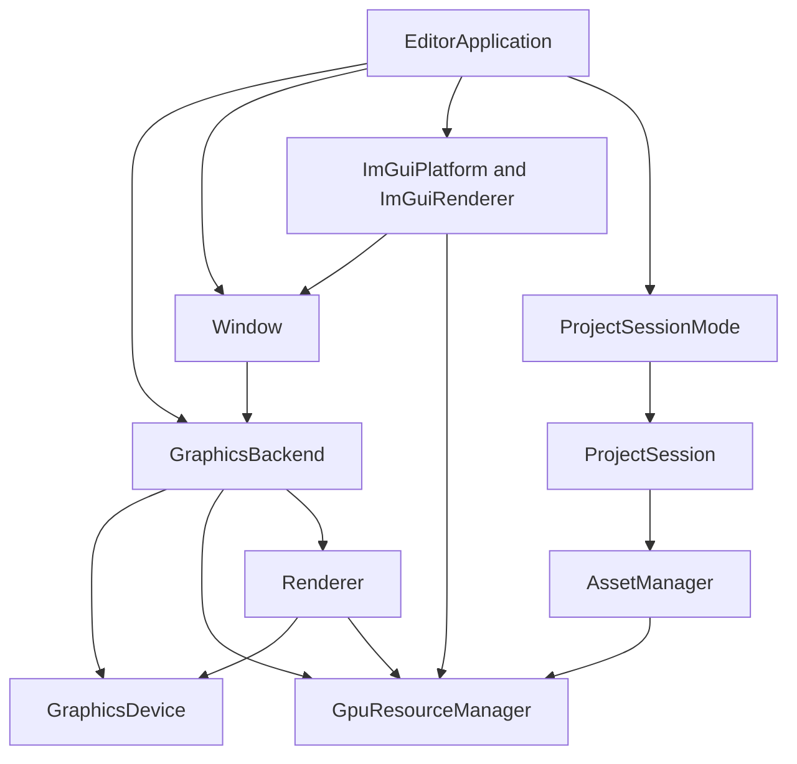

# Architecture

How Crimson is put together, for working on the engine and the editor. Writing shaders has its own page, [shaders.md](shaders.md), and building, testing and releasing are in [development.md](development.md).



## Repository layout

```
Crimson/
  engine/            core, renderer, backends (vulkan/, opengl/), asset manager, scene, resources/
  editor/            Crimson Editor: the application, its modes, the panels, resources/
  tests/             engine/ and editor/ (no GPU), gpu/ (the real backends), support/ (fakes and helpers)
  samples/Demo/      a project with test meshes and materials
  tools/             scripts that make the built-in meshes and the screenshots
  cmake/             embedding files into the executable, linking statically
  docs/              these pages, and the screenshots
  external/          glfw, glad, glm, fmt, imgui, entt, glslang, ImGuizmo, json, nativefiledialog-extended, spirv-cross, SPIRV-Headers, SPIRV-Tools, spirv-reflect, stb_image, tinyobjloader, tracy, VulkanMemoryAllocator
```

Each of `engine/` and `editor/` keeps its headers in `include/` (`crimson/...` and `crimson_editor/...`) and its sources in `src/`.

## Two backends, one API

Vulkan 1.3 (dynamic rendering, synchronization2) and OpenGL 4.5 implement the same `GpuResourceManager` and `Renderer` interfaces, so code above them never touches a native API type. The backend is picked when the `EditorApplication` is created, from `--vulkan` or `--opengl` (see `editor/src/main.cpp`).

### GraphicsBackend

The window makes the graphics backend for its own API, with one call that hands over ownership:

```cpp
auto window = Window::Create(GraphicsApi::Vulkan, data);
auto backend = window->CreateGraphicsBackend();
// backend->Device, ->GPUResources, ->Renderer
```

The window has to outlive the backend. Members are declared so that destruction order is correct (renderer, resources, device). The renderer only holds references; it does not own the device or the resource manager.

### The platform layer and GLFW

**GLFW lives only in `engine/src/platform/glfw/`.** No public engine header mentions it, the graphics devices don't call it, and the editor and the tests neither include nor link it. What the rest of the engine needs from the OS comes through the engine's own types, so another platform layer, such as SDL, can replace the folder:

- **`Window`** (`crimson/core/window.hpp`) is the public interface: size, title, focus, the events below, the cursor, the clipboard, and `CreateGraphicsBackend()`.
- **`WindowGraphics`** (`engine/src/platform/window_graphics.hpp`) is what a graphics device needs from the window it draws to: the Vulkan instance extensions and surface, and for OpenGL making the context current, the swap interval, swapping buffers and the function loader. The GLFW window implements it next to `Window`, and passes itself to the devices. It exists only in `engine/src`.
- **One helper chooses the API.** `CreateGraphicsBackend(GraphicsApi, Window&, WindowGraphics&)` (`engine/src/graphics/create_graphics_backend.hpp`) holds the one `switch` over the APIs, and the window's own `CreateGraphicsBackend()` calls it. An SDL window would call it the same way.
- **`OSWindowHandle`** names the operating system's own window (an HWND, an X11 `Window`, a `wl_surface*` or an `NSWindow*`), for what has to refer to it outside the engine. The file dialogs use it as the parent of the native dialog.

### Resource management

- Buffers, textures, render targets, shaders and materials are referenced through opaque `Handle<Tag>` values instead of raw pointers. A handle carries an index and a generation, so stale handles are detectable.
- `ResourceManagerBase<Traits>` provides the pools (`Register` / `Get` / `Unregister`); backend traits (`VulkanResourceTraits`, `OpenGLResourceTraits`) define the native types.
- Textures are first-class resources. A `RenderTarget` only references `TextureHandle`s, so any attachment can be sampled by a material or shown in the UI.
- Swapchain images are wrapped as non-owning textures.

## Frames and passes

A frame is recorded into a `FramePacket` through a `FrameRecorder`: an ordered list of passes, the frame's object transforms and its lighting. Recording makes no GPU calls; `Submit` does all of the GPU work, from waiting for the frame's slot to presenting.

```cpp
if (!renderer.CanRender()) // a minimized window
    return;

FrameRecorder frame = renderer.BeginRecording();
frame.Lighting().Lights = lights; // starts empty every frame

ObjectId object = frame.AddObject(transform); // usable in every pass of this frame

// One pass draws all of the shadow views, each into its own tile of the atlas
PassBuilder shadows = frame.AddPass({ .Name = "Shadows", .Target = shadowTarget, .Clear = { .Flags = ClearFlags::Depth } });

for (const ShadowView& shadow : frame.Lighting().Shadows)
{
    ViewId view = frame.AddView({ .ViewProj = shadow.Shadow.ViewProj, .CameraPosition = shadow.Eye }, shadow.Viewport);
    shadows.DrawMesh(mesh, materials, object, { .Variant = ShaderVariant::Depth, .View = view });
}

frame.AddPass({ .Name = "Scene", .Target = sceneTarget, .View = camera, .Reads = { shadowAtlas } }).DrawMesh(mesh, materials, object);

// What is drawn on top of the scene, in the order it was recorded
frame.AddPass({ .Name = "UI", .Kind = PassKind::Overlay }).Draw({ .VertexBuffer = vertices, .IndexBuffer = indices, .Material = material, .Scissor = clip });

renderer.Submit(std::move(frame)); // false when the frame was dropped, like for an out of date swapchain
```

- A pass is a `PassRecord`: its `PassInfo` and its draws. Passes run in the order they are added.
- `PassInfo` holds the pass's `Name` (shown in Tracy), its `Target` (the back buffer when empty), what to `Clear` it to, an optional `Viewport` to limit drawing and clearing to part of it, the `View` (camera) and the textures the pass samples in `Reads`.
- A draw is a `DrawItem`: vertex buffer, index buffer, material, its properties, object, view, `ShaderVariant`, an optional `Scissor` and a `BaseVertex`. `PassBuilder::Draw` adds one, `DrawMesh(mesh, materials, object, options)` one per submesh, each with the material at its slot in `materials`. A `PassBuilder` refers to its pass by index, so it stays valid while more passes are added.
- The frame's views are a list like its objects. Every pass adds its `View` to it, and a draw uses that one unless it names another (`DrawItem::View`, `DrawOptions::View`) from `FrameRecorder::AddView(view, viewport)`. A view added with a viewport draws only to that part of the pass's target, clipped to the pass's own area, and a view outside that area draws nothing. That is how one pass draws many cameras, like the shadows. The pass's `Clear` is still for the pass's whole area.
- The renderers sort each pass's draws: opaque ones first, grouped by shader, material and buffers to rebind as little as possible, then transparent ones from the farthest to the nearest. `DrawMesh` sets a draw's `SortDepth` to the squared distance from its view's camera to the center of the mesh's bounds. Meshes that cross each other can still blend in the wrong order, as each sorts as a whole.
- **A pass has a kind.** A `Scene` pass sorts as above, and tests and writes depth. An `Overlay` pass keeps its draws in the order they were recorded, blends every one, and has no depth test or write, with its material deciding the culling. That is for what is drawn on top of a scene, like the editor's UI and later gizmos. It is a setting of the pass rather than a render mode, as a render mode is saved in `.mat` files and offered in the Inspector.
- **A draw can be cut and offset.** `Scissor`, in the same space as the pass's `Viewport`, limits it to a rect of the target, cut to its view's area. `BaseVertex` is added to each index, so many meshes can share one vertex buffer. `ShaderDataType::UByte4Norm` reads four bytes as floats from 0 to 1, for colors packed into a vertex.
- **Frame ids and tables.** Objects, views and material properties are each kept in a `FrameTable<Tag, T>` of the frame, and named by a `FrameId<Tag>`, which is an index into one frame's table. They are distinct types, so mixing them doesn't compile, and a default id is none, which each kind gives its own meaning: the identity transform for an object, the pass's view for a view, and the material as it is for properties. They have no generations and no free list, as the tables start empty every frame.
- **Material properties for one draw.** `FrameRecorder::AddProperties(MaterialProperties)` returns an id that `DrawItem::Properties` or `DrawOptions::Properties` names, like `{ .MaterialOverride = red, .Properties = tint }`. A `MaterialProperties` is a set of values and textures, each named by a `PropertyId` (the hash of its name, as `Shader.PropertyToID` is in Unity), applied on top of what the draw's material has, without making a material. A property the draw's shader doesn't have is skipped. It is not `DrawOptions::MaterialOverride`, which replaces the whole material. The rules for what a property changes are in one header shared by both backends (`engine/src/renderer/draw_material.hpp`): a draw that sets values gets its own copy of its material's uniform block with the values written over it, and a draw with properties binds its own textures. Vulkan allocates one descriptor set for it from a pool, and OpenGL binds the textures to units. Both are sized from the frame before it is drawn, so there is one pool and one buffer for each frame in flight on Vulkan, and one buffer on OpenGL.
- **Buffers and textures can change.** Dynamic and Stream buffers are updated with `UpdateVertexBuffer` and `UpdateIndexBuffer`, as often as every frame, and what a frame draws is what the buffer held when it was submitted. Vulkan keeps `kMaxFramesInFlight + 1` copies of such a buffer for that, and OpenGL orphans the storage. A Static buffer can't be updated. `UpdateTexture` replaces a `TextureRegion` of a texture without mips, and can also be called while recording.
- Each draw indexes a per-frame buffer of object transforms, filled by `AddObject`, and one of views. Both indices reach the shader in the draw's push constant.
- In debug builds `Submit` checks the passes' `Reads`, and logs once when a pass samples its own target or a texture that a later pass writes.
- Vulkan layout transitions and barriers are handled by the renderer, a pass's `Reads` are made readable before it starts; OpenGL needs none.
- The renderer keeps one `FramePacket` per frame in flight (`kMaxFramesInFlight`), and reuses their memory. Frame-in-flight synchronisation (fences, semaphores, per-frame buffers) is internal to the Vulkan renderer.
- The frame's time, `Time` and `DeltaTime`, comes from a `FrameClock` each renderer owns, and reaches shaders through the frame block.

## Window and input

There is one path from the OS into the engine: the window sends events, and everything else is derived from them. `Window::PollEvents` calls the callback the window was created with, once for each event:

| Event | When |
|:------|:-----|
| `KeyPressEvent`, `KeyReleaseEvent` | a key changes, with its `Key`, the `KeyModifiers` held, and for a press whether it is a repeat |
| `TextInputEvent` | a character was typed, which the keyboard layout and the modifiers decided |
| `MouseButtonPressEvent`, `MouseButtonReleaseEvent` | a `MouseButton` changes |
| `MouseMoveEvent` | the mouse moved: its position in window coordinates, and how far it moved since the event before |
| `MouseLeaveEvent`, `MouseScrollEvent` | the cursor left the window, or the wheel turned |
| `WindowFocusEvent`, `WindowResizeEvent`, `WindowCloseEvent` | the window's own changes |

- **One `Key` enum** (`crimson/core/keys.hpp`) names the whole keyboard by what is printed on its keys in a US layout, whatever the layout in use is. The window drops a key it can't name.
- **`Input` is derived from the events.** `Input::OnEvent` keeps which keys and mouse buttons are down and where the mouse is, and `Update()`, called once a frame after the window polled, turns the movement of that frame into `GetMouseDelta()`. It uses no GLFW and no window, so the tests feed it events directly.
- **The cursor.** `Window::SetCursorLocked` hides the cursor and keeps it where it was locked, while the mouse moves on without stopping at the edge of the screen. The mouse move events then report the locked position with the real delta, so a UI never sees the hidden cursor wander (`CursorTracker`, which has no GLFW and is the same for every platform layer). `SetCursorShape` sets what the cursor looks like, and `GetClipboardText` and `SetClipboardText` read and write the clipboard.

## Rendering

`SceneRenderer` renders in linear light. With `SetToneMapMaterial` set, a frame goes through these passes:

1. Shadows
2. Outline mask, if something is selected
3. The scene, into its own RGBA16F target with a depth buffer. Values can go well above 1.
4. Tone mapping, into the target the caller gave it: exposure, then ACES (or only clamping), then the sRGB encoding
5. Outline, in display colors, so it stays the color it was set to

Lights are kept in a GPU buffer, in the style of glTF's `KHR_lights_punctual`, and there can be any number of directional, point and spot lights. What the default shader does with them, and what colors and intensities mean, is in [shaders.md](shaders.md).

### Shadows

`BuildShadowViews` assigns tiles of one depth atlas to the lights with `CastsShadow` set: one for a directional or spot light, six for a point light. One pass draws them all: it clears the atlas, and each shadow view is a view of the frame with its tile as the viewport, which the casters are drawn with. So the atlas is the only limit on how many lights are shadowed, and every caster is drawn once for every view, as nothing is culled per view yet. Shaders pick the tile through the light's `ShadowIndex`. Shadows are filtered with PCF. The default atlas is 4096x4096 with 1024 tiles. Lights that don't fit in the atlas log a warning and stay unshadowed. Directional lights cover one fixed area of the world, there are no cascades yet.

### Materials of a slot

A renderer's `MaterialAssets` hold the ids it chose. When it draws, an empty or absent entry uses `slot_materials::ForEmptySlot` (the material made for the slot, else the default), which `SceneRenderer` caches per mesh until `AssetManager::Version()` changes, as it builds paths. A chosen material that is missing, or exists but does not load (a broken shader or file), draws `engine/materials/internal/M_Missing.mat`, an unlit magenta one, in every pass, so a broken reference shows and nothing is left out. The tone map and outline materials are held by id too, and set up again in `Record` when their lookup gives a new handle.

### The selection outline

`SceneRenderer` can outline an entity and its children: their meshes are drawn into a mask, and a pass over the whole screen colors the pixels next to it. The color comes from `engine/materials/internal/M_Outline.mat`. Drawing the selection a second time is costly on large meshes; #60 moves it to the stencil buffer.

## Scenes

Scenes are built on [EnTT](https://github.com/skypjack/entt). `Scene` wraps an EnTT registry and `Entity` is a small handle to one of its entities:

```cpp
Entity parent = scene.CreateEntity("Lights");
Entity light = scene.CreateEntity("Sun", parent);
light.AddComponent<LightComponent>().Type = LightType::Directional;
light.GetComponent<TransformComponent>().Position = { 0.0f, 8.0f, 0.0f };

scene.SetParent(light, {}); // back to the top level, it stays where it is in the world
```

| Component | Contents |
|:----------|:---------|
| `NameComponent` | name and an active flag, which also disables the children |
| `TransformComponent` | position, rotation in degrees and scale, relative to the parent |
| `RelationshipComponent` | parent and ordered children |
| `LightComponent` | type, color, intensity, range, cone angles and whether it casts a shadow. It points along its transform's -Z axis. |
| `MeshRendererComponent` | mesh and material assets, and whether it casts shadows |

Every entity has the first three, and the others are optional. Meshes and renderers share one component because there is only one kind of renderer so far. It can be split when something else needs a mesh, such as skinned meshes.

### Components

What scene files know of a component, they know from its registration in `ComponentRegistry`, which the asset manager owns (`AssetManager::Components`). A `ComponentType` has a stable id that files use, a name, and its fields: each with a key, a label, a type (`FieldType`), a default, an asset type for references, enum options, and a range. It also knows how to add, get and remove the component on an entity, and what the editor does with it: its icon, its presets, and which assets can be dropped on it. Fields are read and written as `FieldValue`s, so code that works on components in general, such as saving and the Inspector, never names a C++ type.

A C++ component registers with `ComponentRegistry::Register<T>` (`component_builder.hpp`, which only registration code includes). The builder has a method for each kind of field, and the member's type picks the field's kind, so one of a type no kind holds doesn't compile.

```cpp
auto renderer = registry.Register<MeshRendererComponent>("meshRenderer", "Mesh Renderer");
renderer.Icon("box")
    .Asset("mesh", "Mesh", &MeshRendererComponent::MeshAsset, { .SpawnsFrom = true })
    .AssetList("materials", "Materials", &MeshRendererComponent::MaterialAssets,
               { .Items = MaterialSlots, .DropTarget = true })
    .Field("castsShadows", "Casts Shadows", &MeshRendererComponent::CastsShadows)
    .Preset("3D Object", "Cube", [](MeshRendererComponent& component, const AssetManager& assets) { /* sets its mesh */ });

registry.RegisterRuntime("health", "Health", { FieldInfo{ .Key = "max", .Label = "Max", .Type = FieldType::Int, .Default = int32_t{ 3 } } });
```

- **Native components** register their fields through pointers to their members, which also give their defaults: `Field` for a bool, int, float, vector or string, and `Color`, `Enum`, `Asset` and `AssetList` for the others. Enums are stored as their index, and asset references as `AssetID`s, typed again when they are set. `native_components.cpp` registers Transform, Light, Camera and Mesh Renderer; Name, Relationship, Scene Instance and Instanced are part of what a node is rather than components a file lists. `ComponentRegistry::Find<T>()` finds the type of a C++ component.
- **Runtime components** have no C++ type, like those a script will define (#36). Their values are a `RuntimeComponent` in a pool of the scene's named after their id.
- **Options of a field:** `Range` and `Speed`, `VisibleIf` for what only matters with the component's other values, `Items` for a list whose entries follow another of the component's assets, like a mesh's material slots: one `AssetListItem` per entry, with its label and what it uses while empty, and `UniformToggle` for a vector that can change along all axes together.
- **What the editor does with a component:** `Icon` names a Lucide icon, which can depend on the values. `Preset` adds a way to set it up to the Create menu, under the menu name it is given. `SpawnsFrom` makes an asset dropped in the Scene view an entity with the component, and `DropTarget` sets it on the entity under the mouse.
- **Hooks:** `Constrain` keeps fields consistent. A component holds asset ids only, so nothing has to be updated after an edit: `ApplyPreset`, `AssignAsset` and `CaptureComponent` just set and read the fields. `AssignAsset` first sizes a list to its `Items`.
- `ReadComponent`, `WriteComponent` and `CopyComponent` work on any registered component.

In the editor, the Inspector draws each registered component an entity has from its fields (`DrawComponentFields`): a row per visible field, by its type, that resets to its default. An asset field is drawn by `AssetField`. No component has a look of its own, so a new one gets the same rows, entry names and uniform toggle by registering them. **Add Component** lists the types that can be added, and a component the editor doesn't know shows as a line that says it is kept. Icons come from `ComponentIcon`, which the Hierarchy uses too.

A camera looks along its -Z axis from its entity's position, like a light, and is either perspective (a vertical field of view) or orthographic (a size, which is half the height of the view in world units). `ComputeCameraView` (`scene_camera.hpp`) gives its view, projection and position for an aspect ratio and the entity's world matrix, with the scale left out, using the same clip space as the editor camera. `FindMainCamera` resolves the scene's main camera: the one its settings refer to while it is active and has a camera, otherwise the first active one in hierarchy order, otherwise none.

The renderer, picking and the camera still use the C++ types directly, as they are what the components are for rather than ways to edit or save them.

`SceneRenderer` turns a scene into a frame: it gathers the active lights into `FrameLighting`, looks up every active renderer's mesh and materials by id each frame (so a reloaded mesh or a material made again shows at once), gives it an object transform, and records the passes under [Rendering](#rendering).

### Scene files

A scene is saved as a `.scene` asset: readable JSON with the entities nested the way they are in the hierarchy, and the scene's ambient light, main camera, exposure and tone mapper (`SceneSettings`). `CaptureScene` turns a `Scene` into a `SceneData` that `scene_data::Write` writes, and `scene_data::Parse` and `InstantiateScene` go the other way.

```json
{
  "version": 1,
  "environment": { "ambient": [0.05, 0.05, 0.05], "exposure": 1.0, "toneMapper": "aces" },
  "mainCamera": "5be2c90d7a41f3a8",
  "entities": [
    {
      "id": "a7c31e5d90b24f16",
      "name": "Floor",
      "position": [0, -0.5, 0],
      "meshRenderer": { "mesh": "meshes/floor.obj", "materials": ["materials/floor.mat"] },
      "children": []
    },
    { "id": "63fd20ab1c8e47d9", "name": "Crate", "position": [2, 0, 0], "instance": "scenes/crate.scene" }
  ]
}
```

Every entity has an id, which stays the same across loads. The entities of a hand-written file that have none get one written into the file the first time it is read, and a file that can't be written then doesn't open. The engine's own scenes have their ids checked in.

`mainCamera` is the id of the entity that is the scene's main camera, and is left out while none is chosen. A file without it, as older ones are, loads as none chosen, and an id with no entity keeps its reference, so that undoing a delete makes it work again.

`CaptureNode` and `ApplyNode` capture and set one entity apart from its children, which undo uses.

A new scene is a copy of `engine/scenes/internal/SC_NewScene.scene`, which has a sun, with every entity given an id of its own.

There are no prefabs, as any scene can be used inside another one as an instance. An instance is an entity with the other scene's roots as its children. Its own name, transform and active flag are saved with it, while what is under it comes from the other scene's file each time the scene opens, and can't be changed from here. There are no per-instance overrides yet (#20). A scene that would end up containing itself can't be dropped in, and one written that way by hand leaves that instance empty.

Each component is a key of its entity, by its type's id, with its fields by their keys. A field the file doesn't have gets its default. The transform is a component like the others in a `SceneNode`, but a type can be part of the node (`PartOfNode`), which puts its fields among the node's own keys (`position`, `rotation`, `scale`). The ids of components can't be one of those keys, or `id`, `name`, `active`, `instance` or `children`. A component whose type isn't registered, such as one from a script that isn't loaded, is kept as it was: on the entity in `UnknownComponents`, and written back the same when the scene is saved. When a referenced asset moves, the references in the asset fields of the registered components are updated.

Hand-written references can be plain paths. Saving writes both the id and the path, and an empty material slot stays empty in the file, so it can still find its material. A reference that can't be found is logged, and is gone once the scene is saved again. A file that can't be read, including one from a newer version, opens no scene at all, so that saving can't overwrite it.

## Asset pipeline

`AssetManager` scans a project's `assets/` folder and dispatches files to its importers:

| Importer | Produces | Its file holds | New one |
|:---------|:---------|:---------------|:--------|
| `TextureImporter` | `TextureHandle` | an image, no data | no |
| `ShaderImporter` | `ShaderHandle` (`.hlsl`, compiled with glslang) | source, no data | a simple lit shader |
| `MaterialImporter` | `MaterialHandle` (`.mat`) | `MaterialData` | a material on `S_Lit` |
| `MeshImporter` | `Mesh` (vertex/index buffers, sub-meshes and slot names, e.g. `.obj`) | geometry, no data | no |
| `SceneImporter` | nothing, as a scene isn't loaded to the GPU | `SceneData` | a copy of the engine's template scene |

Assets are addressed by a path relative to `assets/`, or by `AssetID`, and load on first use with `Get`. A load that fails is logged once and gives null. A file's id lives in the `.meta` written next to it, so those belong in version control.

Where the type is known, ids carry it: `TextureID`, `MeshID`, `ShaderID`, `MaterialID` and `SceneID` are `TypedAssetID<TextureAsset>` and so on, each defined in its type's header, so a material's shader can't be given a texture, and ids of different types don't compare. Only the asset manager makes one, after checking the type, with `As<T>(id)` or `Find<T>(path)`. One turns back into a plain `AssetID` by itself, which is what the selection, drag and drop and the removed assets use. `Get(id)` gives what that type loads as, and `Get<T>(path)` is the shortcut for code that knows the path. A reference that is missing keeps the type it was read as, so it stays typed until its file is back. `AssetType` is the type's name as files write it, made with `AssetType::Of<T>()` and asked with `Is<T>()`, and a default one means none. Each type that loads keeps what it loaded in its own `AssetStore<T>` (`engine/include/crimson/asset_manager/asset_store.hpp`). Every asset has a slot there, and for every type the slot also keeps the data it is using (`Data`, for the types whose files hold data), the files it was made from with their times (`Files`, which is how a change on disk is noticed), and the assets it was made from (`Uses`).

Everything else holds ids and looks them up when it uses them: components, undo snapshots and the renderer never keep a loaded asset or a copy of one. `Get` returns a `const LoadedAsset<T>*`, the same for every type, or null when the asset can't be had: an invalid or missing id, one of another type, or one that failed to load. It loads on demand, and the pointer stays where it is while the asset is reloaded or updated (the contents change in place), but is gone once the asset is removed, so keep the id and look up again each frame. A lookup on a loaded asset costs a scan of the registered types, one hash lookup by id and a check, with no file access, parsing, allocation or string hashing. `Version()` is one counter for the whole manager that changes when assets are added, removed, renamed or loaded again, which is for whatever caches something worked out from the assets, like the Assets panel's tree and the renderer's empty-slot materials. First loads and `Apply` leave it.

`AssetManager` has no method of its own for a type. What a type's files say, and how it is made and updated, belongs to the type:
- Its struct, such as `MaterialAsset`, beside its importer in `importers/<type>_asset.hpp`, says everything specific to the type: its `Name` in files, what loading gives (`Loaded`), what the file holds (`Data`), how to `Parse` and `Write` that when it holds data, such as `MaterialData` and `SceneData` (the others have `NoAssetData`), and the types it is made from (`Uses`). `CompleteAssetType` checks that a struct has all of it.
- Its importer, besides `Load` and `Unload`, can say how a new file of the type starts (`NewFile`), how the references in its file follow an asset that moved (`UpdateReferences`), whether a change to its file loads it again (`ReloadsWhenChanged`), how to make the asset from edited data (`Create`), how to show other data without making it again (`Update`), how to point it at an asset it uses that was loaded again or removed (`UpdateUse`), and how to free what it shares between its assets (`ReleaseShared`). Each has a default that does nothing, so a type only writes the ones it needs.

A type is registered at runtime with `AssetManager::RegisterType<T, Importer>()`, which names the type's importer and adds it and, for a type that loads, the store. The importer depends on the type, not the other way round. The engine's own types are registered by `RegisterBuiltinAssetTypes`, as its components are by `RegisterNativeComponents`, and nothing else names them all. A type is refused until the types it uses are registered, so `Types()` lists each after what it uses, and the manager unloads in the reverse order, users before what they use. Adding a type is its struct, its importer and its registration, where the importer must make what the struct says it loads (`ImporterFor`). The editor's view of a type, its icon, color and inspector, is separate.

The asset manager changes what it has while running with these, which work for any type that has what they need:
- `Refresh` looks at the folder again, and `Rename` and `Delete` change files.
- `Read` gives what a file says, `Save` writes data to it and `Create` makes a new file, from the data if given, or else the importer's `NewFile`. `ReadSource` gives a file's bytes, for what has no data.
- `GetData` gives what an asset is using right now, which edits may have made different from its file, and `Apply` shows other data on it. A material's color changes in place, and only a different shader makes a new material. `Apply` says which it was: `AssetUpdate::Updated` or `Replaced`.
- `Reimport` stores new import settings in the asset's `.meta`, and loads it again if it was loaded. That includes meshes: what draws one looks it up by id.
- `ReloadChanged` loads the assets again whose file, or a file they include, changed, for the types that ask for it. That is the shaders, which also remake the materials using them. One that no longer loads keeps its last working version.

A loaded asset knows what it was made from (`ImportContext::Uses`: a material's shader and textures). That is how a reload or a removal reaches the assets using it, without the manager naming a type: they are updated first, in place if their importer can, or else made again from their data, so unsaved edits survive. Only then is the old version freed, so nothing uses a handle that is gone. Removing a texture leaves its materials with the engine's empty texture in its place, and removing a shader unloads the materials using it.

Every file the manager writes (assets, new files, updated references and `.meta` files) goes through a temporary file next to it that is then renamed over it, so a write that fails halfway leaves the old file. A `.saving` file left by a crash isn't picked up as an asset.

What an import makes can be kept in an `ImportCache`, which any importer reaches through `ImportContext::Cache`. An importer gives it a key, which it builds itself from everything that decides the result, and the bytes it made, and finds them again by that key. Entries are kept in memory for the process, which is shared by every cache, and in `<folder>/<kind>/` with a subfolder per importer. The files have a checksummed header, are written to a temporary file of their own and renamed so that two editors can use one folder, and one that can't be read, is broken or has an old format is a miss. An entry also lists the files its import read, each with where it came from (a file or an engine resource) and a hash of its contents, or that it wasn't there. Those are checked on every hit, from memory or disk, so a changed file is a miss, and so is one that appears where there was none. A hit hands the files back for the asset to reload when they change. Project files are kept relative to the project's assets folder, so a project that moves keeps its cache. The asset manager chooses the folder: `.crimson/cache/` in the project's data folder for what comes from the project, and the user cache folder for the engine's own assets, as every project uses them. Nothing removes old entries, and the folders can be deleted at any time.

Shaders are the first to use it, as glslang and SPIRV-Tools take most of the time of opening a project. The compiler doesn't know about it: `shader_compiler::Compile` compiles and reports the includes it read, and `ShaderImporter` does the rest. The key is a hash of the shader's name, its source, the compilers' versions, their settings and the optimizer passes, and the shader format. The entry holds the stages and their interface SPIR-V. Every include the compile read is a dependency, and an engine header also depends on the shader's folder not having a file of that name, so a project file that now shadows it is a miss. Annotations aren't stored. They are read from the source on every load, so the warnings about ones that can't be understood show up whether it was cached or not.

A file moved along with its `.meta` keeps its id. Moving an asset while the engine runs also updates the `.mat` and `.scene` files that reference it, even if they only name its path. A reference with only a path breaks if the file moves while nothing is running. A reference to an asset that isn't there, because its file is gone or was deleted, keeps its id and path: it is saved as it was, shows as missing in the Inspector, and works again once the file is back. Opening a scene that has any warns about how many. Anything that changes GPU resources has to run between frames, which is why panels queue these in `EditorContext::Deferred`.

A mesh's material slots fill themselves in when it is drawn, and stay empty in the file: an empty slot uses `materials/<slot name>.mat` next to the mesh if that file exists, and the default material if not. For an `.obj`, the slot names are the material names in its `.mtl`. **Create Materials from .mtl**, on an `.obj` in the Assets panel (`slot_materials::Create`, in `slot_materials.hpp`), writes those files from the `.mtl` for the slots that have none, and never replaces one. Each is a material on `S_Lit`:

| `.mtl` | Material |
|:-------|:---------|
| `map_Kd` | `ColorMap` |
| `Kd` | `Color`, only without `map_Kd`, as exporters write a gray there that would darken the texture |
| `norm`, else `map_bump`, else `map_Disp` | `NormalMap`, with sRGB turned off on the texture |
| `Pr`, else `Ns` | `Roughness`, from `Ns` as `1 - sqrt(Ns / 1000)` |
| `Pm` | `Metallic` |
| `Ke`, `map_Ke` | `EmissiveColor`, `EmissiveMap` |
| `d` between 0 and 1 | transparent, with `d` as the alpha. A `d` of 0 is ignored, as exporters write it for opaque materials. |
| `map_d` | cutout, cut by the color texture's own alpha, as exporters give the mask separately even when the color texture has it |

Texture paths are relative to the `.mtl`, and one that isn't there is logged and left empty. What `S_Lit` has no slot for, such as `map_Ks`, is logged and left out. A value at the shader's default isn't written.

`.mat` files can also set `"renderMode"` (`"opaque"`, `"transparent"` or `"cutout"`) and `"cull"` (`"back"`, `"front"` or `"none"`), which default to opaque and back. Transparent materials are alpha blended using the alpha the shader outputs, don't write depth, and draw after opaque ones in the order they were submitted. Cutout materials draw like opaque ones, but where the alpha is under the shader's `AlphaCutoff` there is nothing.

The shadow passes and the selection outline's mask only need depth, so they draw each mesh with its own material in `ShaderVariant::Depth`: its shader's `VSMain` and, if it declares one, its `PSDepth`, drawn as opaque. That is how a cutout's holes, or a shader that moves vertices, show up in its shadow. `shader_compiler::Compile` puts `PSDepth` in `ShaderBinary::PixelDepth`. Each backend makes a depth version of every shader from it: on Vulkan a pipeline with `GraphicsPipelineInfo::Variant`, and on OpenGL a second program, with only the vertex stage where there is no `PSDepth`. The outline mask is the outlined meshes' depth, which `S_Outline` reads as covered where it is under 1.

### Engine assets

The engine's own shaders, materials, meshes and scenes live in `engine/resources/` and are bundled into the executable (`crimson_embed_resources`, in `cmake/`). They are always available under `engine/`, read-only and with the same ids in every project, so a project's material can use `"shader": "engine/shaders/S_Lit.hlsl"`. They are named with a prefix for their kind (`S_` shaders, `M_` materials, `SM_` meshes, `T_` textures, `SC_` scenes). Whatever is under an `internal/` folder, of any kind, is left out of the asset picker and the Assets panel: the shaders and materials only the renderer uses, for tone mapping, shadows and the selection outline, and the scene a new one is copied from. The picker lists the rest, marked as the engine's, and the Assets panel shows it only with **Show Engine Content**, under an Engine root apart from the project's folders, and a project can't have a folder of its own named `engine`. A renamed engine asset can get a line in `kRenamedEngineAssets` (`engine_renames.hpp`): what was saved with its old path or id still finds it, through any later renames too, and opening a project writes the new path into its `.mat` and `.scene` files.

The built-in meshes are sized like Unity's: `engine/meshes/SM_Cube.obj` (1 m), `SM_Sphere.obj` (1 m across), `SM_Cylinder.obj` and `SM_Capsule.obj` (2 m tall, 1 m across), `SM_Plane.obj` (10 m, facing up) and `SM_Quad.obj` (1 m, facing +Z). `tools/generate_primitives.ps1` makes them, so a change goes there and the script is run again.

The embedded files are kept in Git LFS, like the editor's, and CI pulls `engine/resources/`, `editor/resources/` and `editor/ui/resources/` from LFS before building.

## Editor

`EditorApplication` owns what lives for the whole run (window, graphics backend, input, the recent projects and the user's settings) and shows one `AppMode` at a time. Modes are only swapped between frames, so a mode can free its GPU resources when it is destroyed.

- `ProjectManagerMode` - shown on start. Lists the recent projects, and creates, imports or opens one. `--project <folder>` skips it.
- `ProjectSessionMode` - the editor with one project open. Its `ProjectSession`, scene renderer and panels all live and die with it, and **File > Close Project** goes back to the project manager. The session holds the project's document without a window or a GPU: the asset manager and the assets' edits, the scene and its settings, undo, what is selected, saving, closing and the recovery copies. The mode draws it, and the dialogs ask it what to do.

A project is a folder with a `project.crimson` file and an `assets/` folder. It opens on the scene that was last open, or on its first one, and one with no scenes gets a new `scenes/main.scene`. Opening a project also copies the engine's shader headers into its data folder and lists them in `shadertoolsconfig.json`, so code editors with HLSL Tools find them. The data folder also holds `cache/`, what importing the project's files made, and `recovery/`, copies of unsaved scenes.

### How the UI is drawn and fed

**The engine doesn't link ImGui and has no UI concepts.** The editor's UI layer (below) owns the ImGui context, and `EditorApplication` holds it as one `ui::Host`, made once the window and the backend are final. It is destroyed before them, with the context last. Inside the layer there are two classes of glue, which nothing outside it can see:

- **`ImGuiPlatform`** turns the window's events into ImGui's input events, and keeps the display's size, the time of the frame and the mouse cursor ImGui wants up to date before each `ImGui::NewFrame()`. ImGui's clipboard is the window's. Nothing in the editor reaches into GLFW.
- **`ImGuiRenderer`** records ImGui's draw data as an `Overlay` pass, through `GpuResourceManager` and `FrameRecorder` like any other code. It has one material, made from `editor/ui/resources/shaders/S_ImGui.hlsl`, for all of the UI, and each draw sets its texture with `MaterialProperties`, so there is no material for each texture. Its vertices and indices go into Stream buffers updated every frame, and each ImGui clip rect is the draw's `Scissor`. ImGui's own textures, the fonts, are kept as engine textures: it makes and updates them from the requests ImGui puts in its draw data (`ImGuiBackendFlags_RendererHasTextures`).
- **An `ImTextureID` is a `TextureHandle`.** The layer converts between them (`imgui_convert.hpp`), so showing a render target or a texture asset needs no registering, and a texture can be destroyed without telling ImGui first.

A frame is the mode's `Record`, then `Host::Build`, which starts the UI frame, calls the mode's `DrawUI` and renders it to draw data, and then `Host::RecordPass`, which records that draw data as the UI pass.

### The UI layer

`EditorUI` (`editor/ui/`, headers under `crimson_editor/ui/`) is a static library, and the only code in the editor that knows ImGui and ImGuizmo. They are `PRIVATE` to it, so a panel or a mode that includes `<imgui.h>` doesn't compile, and neither precompiles it. Tests may link ImGui, as they test the layer and its glue. This is how Unreal keeps Slate in modules of their own, and Godot's `editor/` is apart from `scene/gui`. Its parts:

- **Panel framework:** `Panel`, `PanelInfo`, `Workspace` and `Command`, below.
- **Vocabulary:** what panels and modes draw with, in the layer's own types (`ui::Color`, `ui::Rect`, `glm` vectors) and none of ImGui's. `widgets.hpp` (text, buttons, fields, a search box, combos, selectables, tree rows, tiles), `layout.hpp` (`Row`, `TileGrid`, `Region`, `Table`, ids, disabling, fonts, sections, metrics), `menus.hpp` (menus, context menus, popups, modals), `painter.hpp` (shapes, text, icons and images by hand), `drag_drop.hpp`, `gizmo.hpp` (ImGuizmo as one call), `input.hpp` (keys, the mouse and the last item), `window.hpp` and the Inspector's rows in `property_fields.hpp`.
- **Theme, fonts and icons:** the tokens in `editor_theme.hpp`, the fonts and shader in `editor/ui/resources/`, and `icons.hpp`.
- **Host:** `ui::Host` owns the context, the platform glue and the renderer, and applies the theme.

Items drawn in a `Row` share a line. A row only places the items of the window it was started in, so a tooltip or a popup drawn in the middle of it isn't pulled onto its line.

The panels are in the editor, not in the layer, and only use it.

### Panels and menus

Panels derive from `ui::Panel` and are owned by a `ui::Workspace`, which draws the main menu, the dockspace and every open panel into the one frame ImGui builds, which the UI pass records (see above). They share an `EditorContext`, and reach the scene, the assets, their edits, undo and the selection only through its `Session`. A first start builds a default layout, later starts use the one saved in `imgui.ini`, and **View > Reset Layout** restores the default.

- **The descriptor:** a panel passes a `ui::PanelInfo` to `Panel`: its title, an icon, a dock slot, a tab order within the slot, whether it can be closed and whether it is open at the start. The title is the window's key in `imgui.ini`, so it never changes. The slots (`Left`, `Center`, `Bottom`, `Right`, `RightBottom` and `Floating`) are the areas of the default layout, and a panel is docked into its slot's area. The panels are drawn, and so tabbed, by slot and then tab order, never by the order they were added in. A panel a saved layout doesn't know yet docks next to one of its slot. The workspace opens the window and calls the panel's `Draw()` inside it.
- **View:** a toggle with the icon for each panel that can be closed, and **Reset Layout**. Every panel but Scene can be closed. Which panels are closed isn't saved, as ImGui doesn't save it, so they open again on the next start.
- **Commands:** a `ui::Command` has a menu path (`"Edit/Rename"`), a priority, shortcuts, an enabled check and an action. The workspace builds the main menu from them, shows the first shortcut of each, and runs them when their keys are pressed. One given to the workspace is global. One a panel adds with `AddCommand` is scoped: it is in the menu while the panel is open, and its shortcut fires only while the panel has focus. Menus come in the order of their lowest priority and items in the order of theirs, with a separator after a gap of more than 10, as in Unity's `MenuItem`. File starts at 0, Edit at 100 and Create at 200, and View is built by the workspace, last. Context menus stay with their panel, as they depend on what was clicked.
- **Shortcut dispatch:** a chord with Ctrl goes through ImGui's `Shortcut` routing, so a text field that is active keeps the ones it uses (`Ctrl+Z`, `Y`, `A`, `C`, `V` and `X`), while `Ctrl+S` still saves while typing. A chord without Ctrl or Alt, such as `F` or `Delete`, never fires while text is typed. Undo and redo wait until after the frame, like their menu items, as undoing can create entities.
- **Notifications:** `Notifications` shows errors, from anywhere in the engine, and finished saves in the bottom right corner, so they are seen with the Console closed. It reads the same `Logger` the Console does. `ProjectSessionMode` owns it and draws it after the workspace, and clicking a message about a problem shows the Console.

| Panel | What it does |
|:------|:-------------|
| **Scene** | the scene's render target, with an [ImGuizmo](https://github.com/CedricGuillemet/ImGuizmo) gizmo on the selection and a toolbar for its tool and axes. Picking raycasts the meshes' bounds. The toolbar's camera button looks through the selected camera, which stays the one looked through when the selection changes, and pauses the editor camera without moving it. It turns off when that camera is destroyed or loses its component. |
| **Hierarchy** | the entity tree, with search, rename in place and the create menu, which has a submenu for each menu name the components' presets use. Dragging onto an entity reparents, and onto the empty area makes a root. |
| **Inspector** | the selected entity or asset. Entities show their components, drawn from their registered fields (see [Components](#components)), and **Add Component** lists what is registered. Materials show their shader's properties and textures, and edits are saved with **Save All** or `Ctrl+S` and undone with `Ctrl+Z` (`AssetEdits`), and an unsaved material is marked with `*`. Asset fields, a component's and a material's shader and texture slots, are object fields with a picker button: the asset's icon or thumbnail and its name, and a window with a search box, a list or grid view, **None** and the current asset highlighted (`AssetPicker`). A choice applies at once, Enter or a double-click closes it, and Escape puts back what the field had. The picker closes once the field that opened it isn't drawn any more, and each selection's fields have ids of their own, so a choice never reaches another selection's field. Clicking the name shows the asset in the Assets panel. Textures show their import settings, and meshes and shaders their details. |
| **Assets** | the project's files and the engine's, with a folder tree, a grid, search, and dragging into the Inspector or the Scene view. In the Scene view, what a component registered as `SpawnsFrom` (a mesh) makes a new entity, what one registered as `DropTarget` (a material) goes on the entity under the mouse, and a scene becomes an instance. Shaders open in the External Script Editor, other files in the system's program (`system_shell.hpp`). Files changed outside the editor appear when it regains focus. |
| **Console** | the log, grouped and filtered by level. It can be logged to from any thread: entries wait in a queue until the panel is drawn. |
| **Scene Settings** | what is saved with the scene apart from its entities: ambient light, the main camera (a picker of its cameras, or Automatic, the first active one), and post-processing (exposure and tone mapper) for now |
| **Stats** | FPS, frame, CPU and wait times, draw calls, triangles, passes and bind counts |
| **Shadow Map** | the shadow atlas |

The Scene view is seen from the editor's own camera (`PerspectiveCamera`, moved by `SceneCameraController`), which isn't part of the scene and is never saved. `SceneView` picks what the view is seen from, rendering, picking, drops and the gizmo all read: that camera, or a scene camera while one is looked through. Looking through only pauses the editor camera, so turning it off puts the view back where it was.

### Undo

`EditHistory` holds the steps, the limit of 100 and `Commit`, `Undo` and `Redo`, and knows nothing about what is edited. The editable parts are its sources (`EditSource`), added in the order they are collected from. On `Commit` each hands over what changed since the last one as changes (`EditChange`), and if any did, they are one step. Undo applies a step's changes in reverse and redo forward, so the scene's and the assets' edits are undone in the order they were made. A source and what its changes refer to have to outlive the history.

- **Scene:** `SceneEdits` works like Unity's `Undo.RecordObject`: code that changes the scene records what it is about to change (`Record`), creates (`RecordCreated`) or destroys (`RecordDestroy`), through `ProjectSession::GetSceneEdits()`, and the commit keeps each recorded entity that did change as it was before and after. Undo puts back only those, so the rest of the scene, its entity handles and the Hierarchy's open nodes stay as they are. A deleted entity comes back with what was under it, its ids and its place among its siblings. A step keeps whole states rather than what was done, so an edit nobody recorded only means that one can't be undone.
- **Assets:** `AssetEdits` keeps one table of edits per asset type, made on first use, so a type that can be edited needs only its Inspector to call `Get` and `Set`. `Set` records the asset's state from before the step by itself, so panels never record assets. Undo and redo put a state back like an edit, through `Apply` between frames, and a step for an asset that has gone is skipped. Saving isn't a step, so undoing past a save shows the unsaved mark again.

- **Capturing and setting:** `CaptureNode` and `ApplyNode` capture and set one entity through the component registry, the way a scene file does. `CaptureComponent` captures the component as it is, so an undone material drop leaves the slot empty again.
- **Who records:** the Hierarchy and the Scene view record their edits through `ProjectSession::GetSceneEdits()`. The Inspector and the gizmo change the selected entity directly, and Scene Settings the scene's settings, so the session records those whenever nothing is being edited.
- **When a step ends:** on the frame after an ImGui item stops being active, the gizmo stops being dragged (`EditorContext::GizmoInUse`) or the asset picker closes, so what a field takes from the picker belongs to the step. Also after deferred actions ran, or after a panel calls `ProjectSession::MarkEdited` for an edit done at once. The session asks the mode whether anything is being edited, so it needn't know what. The Inspector marks it too, so a drop onto a field ends its step right away. The check a few times a second for the unsaved mark ends any other. A whole drag, typing a name or a visit to the picker is one step, and undo first ends the step being recorded.
- **The selection:** an entity that undo brings back is a new one, so it is selected again by its id if it was selected before the edit.
- **What resets it:** opening a scene, which also drops the asset steps. Unsaved asset edits stay, but can't be undone from the other scene. Undoing back to the saved state clears the unsaved mark, as that compares the scene and the assets with what was saved.
- **The shortcuts:** `Ctrl+Z`, and `Ctrl+Y` or `Ctrl+Shift+Z`, except in a text field, which has its own undo. The 100 latest steps are kept.
- **Not covered:** anything done to asset files, like deleting, renaming or importing them.

### Recovering unsaved scenes

A copy of the open scene's unsaved changes is kept, to offer back after the editor didn't close normally. `RecoveryFiles` keeps named copies in `.crimson/recovery/`, knowing only names and bytes. It writes them on one background thread through `WriteFileSafely` (a temp file, then a rename), and from the main thread everything behaves as if the writes were synchronous: asking about a file waits for its write.

- **Writing:** every 30 seconds, `ProjectSession` captures the scene and serializes it on the main thread, as that reads the registry and the asset manager. It writes only if the scene differs from its file and from the last copy, so only the disk write is on the other thread. A copy is named `<scene id>.scene`.
- **Offering:** every scene load checks for a copy. One that isn't newer than the scene's file is deleted without asking. A newer one opens a **Recover Scene** dialog with when it was written. **Restore** loads it as unsaved changes: the file is untouched until the scene is saved. **Discard** deletes the copy.
- **Removing:** on a successful save, on a normal close of the project, quitting or switching scenes (including **Discard** in the unsaved changes dialog), when the scene's changes are undone back to its file, and when the scene's file is deleted. Only a copy this session wrote or restored is removed, so one that was offered and not answered stays for next time.
- **Not covered:** unsaved asset edits (#146).

### Look and layout

- **Theme:** the editor's colors and sizes are named once in `crimson_editor/ui/editor_theme.hpp` as design tokens (surfaces, one accent, status colors, a spacing scale, one radius, a type scale and a muted color for each kind of asset), and panels use those names rather than writing values out. The size follows the monitor's scaling when the editor starts. [ui.md](ui.md) has the tokens and the rules for them.
- **Fonts and icons:** Inter Regular and Bold are used for text, at 14 px, with the [Lucide](https://lucide.dev) icon font merged into both, so a label can hold an icon from `crimson_editor/ui/icons.hpp`. Inter is loaded without its private use area, which is where Lucide's icons are. The fonts live in `editor/ui/resources/` and are bundled like the engine's resources, but never go through the asset manager. Their licenses are in [THIRD_PARTY_NOTICES.md](../THIRD_PARTY_NOTICES.md).
- **Inspector rows:** they come from `crimson_editor/ui/property_fields.hpp`.
  - The label sits in a column on the left.
  - Vector fields have a stripe for each axis.
  - Right-clicking a field or its label offers **Reset to default**: a component's own default, a material property's `@default` from its shader, or no texture.

### Per-user files

Kept in `%APPDATA%/Crimson` on Windows, and `~/.config/crimson` elsewhere:

- `imgui.ini`: the layout
- `recent_projects.json`: the projects the project manager lists, and the scene each was last on
- `settings.json`: the preferences, such as the External Script Editor

What can be made again is kept in the cache folder instead, which holds nothing else: `%LOCALAPPDATA%/Crimson/Cache` on Windows, and `~/.cache/crimson` elsewhere (`$XDG_CACHE_HOME/crimson` if it is set). What importing the engine's own assets makes goes in it, with a folder per kind of import:

- `shaders/`: the compiled built-in shaders. `CRIMSON_CACHE` names another folder to use instead, as the GPU tests and CI do to share one.
