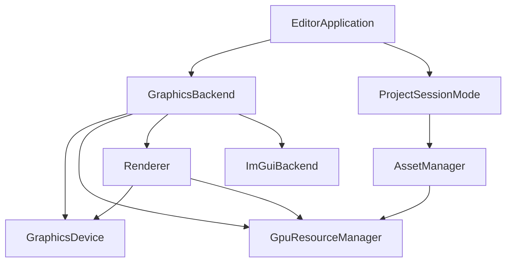

# Architecture

How Crimson is put together, for working on the engine and the editor. Writing shaders has its own page, [shaders.md](shaders.md), and building, testing and releasing are in [development.md](development.md).



## Repository layout

```
Crimson/
  engine/            core, renderer, backends (vulkan/, opengl/), asset manager, scene, resources/
  editor/            Crimson Editor: the application, its modes, the panels, resources/
  tests/             engine/ and editor/ (no GPU), gpu/ (the real backends), support/ (fakes and helpers)
  samples/Demo/      a project with test meshes and materials
  tools/             scripts that make the built-in meshes and the screenshots
  cmake/             embedding files into the executable, linking statically
  docs/              these pages, and the screenshots
  external/          glfw, glad, glm, fmt, imgui, entt, glslang, ImGuizmo, json, nativefiledialog-extended, spirv-cross, spirv-reflect, stb_image, tinyobjloader, tracy, VulkanMemoryAllocator
```

Each of `engine/` and `editor/` keeps its headers in `include/` (`crimson/...` and `crimson_editor/...`) and its sources in `src/`.

## Two backends, one API

Vulkan 1.3 (dynamic rendering, synchronization2) and OpenGL 4.5 implement the same `GpuResourceManager` and `Renderer` interfaces, so code above them never touches a native API type. The backend is picked when the `EditorApplication` is created, from `--vulkan` or `--opengl` (see `editor/src/main.cpp`).

### GraphicsBackend

A single factory call creates the whole graphics subsystem and hands over ownership:

```cpp
auto backend = GraphicsBackend::Create(GraphicsApi::Vulkan, *window);
// backend->Device, ->GPUResources, ->Renderer, ->Imgui
```

Members are declared so that destruction order is correct (ImGui, renderer, resources, device). The renderer only holds references; it does not own the device or the resource manager.

### Resource management

- Buffers, textures, render targets, shaders and materials are referenced through opaque `Handle<Tag>` values instead of raw pointers. A handle carries an index and a generation, so stale handles are detectable.
- `ResourceManagerBase<Traits>` provides the pools (`Register` / `Get` / `Unregister`); backend traits (`VulkanResourceTraits`, `OpenGLResourceTraits`) define the native types.
- Textures are first-class resources. A `RenderTarget` only references `TextureHandle`s, so any attachment can be sampled by a material or shown in the UI.
- Swapchain images are wrapped as non-owning textures.

## Frames and passes

A frame is recorded into a `FramePacket` through a `FrameRecorder`: an ordered list of passes, the frame's object transforms and its lighting. Recording makes no GPU calls; `Submit` does all of the GPU work, from waiting for the frame's slot to presenting.

```cpp
if (!renderer.CanRender()) // a minimized window
    return;

FrameRecorder frame = renderer.BeginRecording();
frame.Lighting().Lights = lights; // starts empty every frame

ObjectId object = frame.AddObject(transform); // usable in every pass of this frame

// One pass draws all of the shadow views, each into its own tile of the atlas
PassBuilder shadows = frame.AddPass({ .Name = "Shadows", .Target = shadowTarget, .Clear = { .Flags = ClearFlags::Depth } });

for (const ShadowView& shadow : frame.Lighting().Shadows)
{
    ViewId view = frame.AddView({ .ViewProj = shadow.Shadow.ViewProj, .CameraPosition = shadow.Eye }, shadow.Viewport);
    shadows.DrawMesh(mesh, object, { .Variant = ShaderVariant::Depth, .View = view });
}

frame.AddPass({ .Name = "Scene", .Target = sceneTarget, .View = camera, .Reads = { shadowAtlas } }).DrawMesh(mesh, object);

frame.AddNativePass({ .Name = "UI", .Clear = { .Flags = ClearFlags::Color } },
                    [](const NativeContext& context) { /* ImGui, debug draw, ... */ });

renderer.Submit(std::move(frame)); // false when the frame was dropped, like for an out of date swapchain
```

- A pass is a `PassRecord`: its `PassInfo` and either draws or a native callback. Passes run in the order they are added.
- `PassInfo` holds the pass's `Name` (shown in Tracy), its `Target` (the back buffer when empty), what to `Clear` it to, an optional `Viewport` to limit drawing and clearing to part of it, the `View` (camera) and the textures the pass samples in `Reads`.
- A draw is a `DrawItem`: vertex buffer, index buffer, material, object, view and `ShaderVariant`. `PassBuilder::Draw` adds one, `DrawMesh(mesh, object, options)` one per submesh. A `PassBuilder` refers to its pass by index, so it stays valid while more passes are added.
- The frame's views are a list like its objects. Every pass adds its `View` to it, and a draw uses that one unless it names another (`DrawItem::View`, `DrawOptions::View`) from `FrameRecorder::AddView(view, viewport)`. A view added with a viewport draws only to that part of the pass's target, clipped to the pass's own area, and a view outside that area draws nothing. That is how one pass draws many cameras, like the shadows. The pass's `Clear` is still for the pass's whole area; `PassBuilder::ClearArea(area, clear)` clears only part of it, after the pass's own `Clear` and before its draws, so the shadows can redraw one tile and keep the rest.
- The renderers sort each pass's draws: opaque ones first, grouped by shader, material and buffers to rebind as little as possible, then transparent ones from the farthest to the nearest. `DrawMesh` sets a draw's `SortDepth` to the squared distance from its view's camera to the center of the mesh's bounds. Meshes that cross each other can still blend in the wrong order, as each sorts as a whole.
- A native pass runs a callback with `NativeContext` (device, command buffer, color format) between engine-managed layout transitions. ImGui is rendered this way, so the engine itself has no UI concepts. The callback runs inside `Submit`, so it captures by value or references what outlives the frame.
- Each draw indexes a per-frame buffer of object transforms, filled by `AddObject`, and one of views. Both indices reach the shader in the draw's push constant.
- In debug builds `Submit` checks the passes' `Reads`, and logs once when a pass samples its own target or a texture that a later pass writes.
- Vulkan layout transitions and barriers are handled by the renderer, a pass's `Reads` are made readable before it starts; OpenGL needs none.
- The renderer keeps one `FramePacket` per frame in flight (`kMaxFramesInFlight`), and reuses their memory. Frame-in-flight synchronisation (fences, semaphores, per-frame buffers) is internal to the Vulkan renderer.
- The frame's time, `Time` and `DeltaTime`, comes from a `FrameClock` each renderer owns, and reaches shaders through the frame block.

## Rendering

`SceneRenderer` renders in linear light. With `SetToneMapMaterial` set, a frame goes through these passes:

1. Shadows
2. Outline mask, if something is selected
3. The scene, into its own RGBA16F target with a depth buffer. Values can go well above 1.
4. Tone mapping, into the target the caller gave it: exposure, then ACES (or only clamping), then the sRGB encoding
5. Outline, in display colors, so it stays the color it was set to

Lights are kept in a GPU buffer, in the style of glTF's `KHR_lights_punctual`, and there can be any number of directional, point and spot lights. What the default shader does with them, and what colors and intensities mean, is in [shaders.md](shaders.md).

### Shadows

`BuildShadowViews` assigns tiles of one depth atlas to the lights with `CastsShadow` set: one for a directional or spot light, six for a point light. One pass draws them all: it clears the atlas, and each shadow view is a view of the frame with its tile as the viewport, which the casters are drawn with. So the atlas is the only limit on how many lights are shadowed, and every caster is drawn once for every view, as nothing is culled per view yet. Shaders pick the tile through the light's `ShadowIndex`. Shadows are filtered with PCF. The default atlas is 4096x4096 with 1024 tiles. Lights that don't fit in the atlas log a warning and stay unshadowed. Directional lights cover one fixed area of the world, there are no cascades yet.

### The selection outline

`SceneRenderer` can outline an entity and its children: their meshes are drawn into a mask, and a pass over the whole screen colors the pixels next to it. The color comes from `engine/materials/internal/M_Outline.mat`. Drawing the selection a second time is costly on large meshes; #60 moves it to the stencil buffer.

## Scenes

Scenes are built on [EnTT](https://github.com/skypjack/entt). `Scene` wraps an EnTT registry and `Entity` is a small handle to one of its entities:

```cpp
Entity parent = scene.CreateEntity("Lights");
Entity light = scene.CreateEntity("Sun", parent);
light.AddComponent<LightComponent>().Type = LightType::Directional;
light.GetComponent<TransformComponent>().Position = { 0.0f, 8.0f, 0.0f };

scene.SetParent(light, {}); // back to the top level, it stays where it is in the world
```

| Component | Contents |
|:----------|:---------|
| `NameComponent` | name and an active flag, which also disables the children |
| `TransformComponent` | position, rotation in degrees and scale, relative to the parent |
| `RelationshipComponent` | parent and ordered children |
| `LightComponent` | type, color, intensity, range, cone angles and whether it casts a shadow. It points along its transform's -Z axis. |
| `MeshRendererComponent` | mesh and material assets, and whether it casts shadows |

Every entity has the first three, and the others are optional. Meshes and renderers share one component because there is only one kind of renderer so far. It can be split when something else needs a mesh, such as skinned meshes. The Inspector, the scene files and the renderer each know these types by hand today; #61 moves them to a registry, so components can also come from scripts.

`SceneRenderer` turns a scene into a frame: it gathers the active lights into `FrameLighting`, gives every active renderer an object transform, and records the passes under [Rendering](#rendering).

### Scene files

A scene is saved as a `.scene` asset: readable JSON with the entities nested the way they are in the hierarchy, and the scene's exposure, tone mapper and ambient light. `CaptureScene` turns a `Scene` into a `SceneData` that `WriteSceneData` writes, and `ParseSceneData` and `InstantiateScene` go the other way.

```json
{
  "version": 1,
  "environment": { "ambient": [0.05, 0.05, 0.05], "exposure": 1.0, "toneMapper": "aces" },
  "entities": [
    {
      "id": "a7c31e5d90b24f16",
      "name": "Floor",
      "position": [0, -0.5, 0],
      "meshRenderer": { "mesh": "meshes/floor.obj", "materials": ["materials/floor.mat"] },
      "children": []
    },
    { "id": "63fd20ab1c8e47d9", "name": "Crate", "position": [2, 0, 0], "instance": "scenes/crate.scene" }
  ]
}
```

There are no prefabs, as any scene can be used inside another one as an instance. An instance is an entity with the other scene's roots as its children. Its own name, transform and active flag are saved with it, while what is under it comes from the other scene's file each time the scene opens, and can't be changed from here. There are no per-instance overrides yet (#20). A scene that would end up containing itself can't be dropped in, and one written that way by hand leaves that instance empty.

Hand-written references can be plain paths. Saving writes both the id and the path, and an empty material slot stays empty in the file, so it can still find its material. A reference that can't be resolved is logged, and is gone once the scene is saved again. A file that can't be read, including one from a newer version, opens no scene at all, so that saving can't overwrite it.

## Asset pipeline

`AssetManager` scans a project's `assets/` folder and dispatches files to its importers:

| Importer | Produces |
|:---------|:---------|
| `TextureImporter` | `TextureHandle` |
| `ShaderImporter` | `ShaderHandle` (`.hlsl`, compiled with glslang) |
| `MaterialImporter` | `MaterialHandle` (`.mat`) |
| `MeshImporter` | `Mesh` (vertex/index buffers + materials, e.g. `.obj`) |
| `SceneImporter` | `.scene` files, read by the editor rather than loaded to the GPU |

Assets are addressed by a path relative to `assets/`, or by `AssetID`, and load on first use with `Load`. A load that fails is logged once and gives an invalid handle or null. A file's id lives in the `.meta` written next to it, so those belong in version control.

Where the type is known, ids carry it: `TextureID`, `MeshID`, `ShaderID`, `MaterialID` and `SceneID` are `TypedAssetID<T>`, so a material's shader can't be given a texture, and ids of different types don't compare. Only the asset manager makes one, after checking the type, with `As<T>(id)` or `Find<T>(path)`. One turns back into a plain `AssetID` by itself, which is what the selection, drag and drop and the removed assets use. `Load(id)` gives what that type loads as, and `Load<T>(path)` is the shortcut for code that knows the path. A reference that is missing keeps the type it was read as, so it stays typed until its file is back. Each type keeps what it loaded in its own `AssetStore<T>` (`engine/src/asset_manager/asset_store.hpp`), with what only that type needs, such as a material's data or a shader's file times.

The asset manager can also change what it has while running:
- `Refresh` looks at the folder again.
- `CreateMaterial`, `CreateShader`, `Rename` and `Delete` change files.
- `ApplyMaterial` shows new values on a material, and `ReimportTexture` applies new import settings.
- `ReloadChangedShaders` recompiles shaders whose file, or a file they include, changed, and remakes their materials. A shader that no longer compiles keeps its last working version.

A file moved along with its `.meta` keeps its id. Moving an asset while the engine runs also updates the `.mat` and `.scene` files that reference it, even if they only name its path. A reference with only a path breaks if the file moves while nothing is running. A reference to an asset that isn't there, because its file is gone or was deleted, keeps its id and path: it is saved as it was, shows as missing in the Inspector, and works again once the file is back. Opening a scene that has any warns about how many. Anything that changes GPU resources has to run between frames, which is why panels queue these in `EditorContext::Deferred`.

A mesh's material slots fill themselves in: an empty slot uses `materials/<slot name>.mat` next to the mesh if that file exists, and the default material if not. For an `.obj`, the slot names are the material names in its `.mtl`. **Create Materials from .mtl**, on an `.obj` in the Assets panel (`AssetManager::CreateSlotMaterials`), writes those files from the `.mtl` for the slots that have none, and never replaces one. Each is a material on `S_Lit`:

| `.mtl` | Material |
|:-------|:---------|
| `map_Kd` | `ColorMap` |
| `Kd` | `Color`, only without `map_Kd`, as exporters write a gray there that would darken the texture |
| `norm`, else `map_bump`, else `map_Disp` | `NormalMap`, with sRGB turned off on the texture |
| `Pr`, else `Ns` | `Roughness`, from `Ns` as `1 - sqrt(Ns / 1000)` |
| `Pm` | `Metallic` |
| `Ke`, `map_Ke` | `EmissiveColor`, `EmissiveMap` |
| `d` between 0 and 1 | transparent, with `d` as the alpha. A `d` of 0 is ignored, as exporters write it for opaque materials. |
| `map_d` | cutout, cut by the color texture's own alpha, as exporters give the mask separately even when the color texture has it |

Texture paths are relative to the `.mtl`, and one that isn't there is logged and left empty. What `S_Lit` has no slot for, such as `map_Ks`, is logged and left out. A value at the shader's default isn't written.

`.mat` files can also set `"renderMode"` (`"opaque"`, `"transparent"` or `"cutout"`) and `"cull"` (`"back"`, `"front"` or `"none"`), which default to opaque and back. Transparent materials are alpha blended using the alpha the shader outputs, don't write depth, and draw after opaque ones in the order they were submitted. Cutout materials draw like opaque ones, but where the alpha is under the shader's `AlphaCutoff` there is nothing.

The shadow passes and the selection outline's mask only need depth, so they draw each mesh with its own material in `ShaderVariant::Depth`: its shader's `VSMain` and, if it declares one, its `PSDepth`, drawn as opaque. That is how a cutout's holes, or a shader that moves vertices, show up in its shadow. `CompileHlslShader` puts `PSDepth` in `ShaderBinary::PixelDepth`. Each backend makes a depth version of every shader from it: on Vulkan a pipeline with `GraphicsPipelineInfo::Variant`, and on OpenGL a second program, with only the vertex stage where there is no `PSDepth`. The outline mask is the outlined meshes' depth, which `S_Outline` reads as covered where it is under 1.

### Engine assets

The engine's own shaders, materials and meshes live in `engine/resources/` and are bundled into the executable (`crimson_embed_resources`, in `cmake/`). They are always available under `engine/`, read-only and with the same ids in every project, so a project's material can use `"shader": "engine/shaders/S_Lit.hlsl"`. They are named with a prefix for their kind (`S_` shaders, `M_` materials, `SM_` meshes, `T_` textures). The ones only the renderer can use, for tone mapping, shadows and the selection outline, are under `internal/` and left out of the Inspector's pickers and the Assets panel. The Assets panel shows the rest only with **Show Engine Content**, under an Engine root apart from the project's folders, and a project can't have a folder of its own named `engine`. A renamed engine asset can get a line in `kRenamedEngineAssets` (`engine_renames.hpp`): what was saved with its old path or id still finds it, through any later renames too, and opening a project writes the new path into its `.mat` and `.scene` files.

The built-in meshes are sized like Unity's: `engine/meshes/SM_Cube.obj` (1 m), `SM_Sphere.obj` (1 m across), `SM_Cylinder.obj` and `SM_Capsule.obj` (2 m tall, 1 m across), `SM_Plane.obj` (10 m, facing up) and `SM_Quad.obj` (1 m, facing +Z). `tools/generate_primitives.ps1` makes them, so a change goes there and the script is run again.

The embedded files are kept in Git LFS, like the editor's, and CI pulls `engine/resources/` and `editor/resources/` from LFS before building.

## Editor

`EditorApplication` owns what lives for the whole run (window, graphics backend, input, the recent projects and the user's settings) and shows one `AppMode` at a time. Modes are only swapped between frames, so a mode can free its GPU resources when it is destroyed.

- `ProjectManagerMode` - shown on start. Lists the recent projects, and creates, imports or opens one. `--project <folder>` skips it.
- `ProjectSessionMode` - the editor with one project open. Its asset manager, scene and panels all live and die with it, and **File > Close Project** goes back to the project manager.

A project is a folder with a `project.crimson` file and an `assets/` folder. It opens on the scene that was last open, or on its first one, and one with no scenes gets a new `scenes/main.scene`. Opening a project also copies the engine's shader headers into its data folder and lists them in `shadertoolsconfig.json`, so code editors with HLSL Tools find them.

### Panels and menus

Panels derive from `ui::Panel` and are owned by `ui::EditorUI`, which draws the dockspace and every panel inside a single native pass. A first start builds a default layout, later starts use the one saved in `imgui.ini`, and **View > Reset Layout** restores the default.

- **The main menu:** File and View come from `EditorUI`. Panels add their own menus between them through `Panel::OnMainMenuBar`. The Hierarchy adds **Edit** (Rename, Delete) and **Create**, the same as its right-click menu. The Preferences window adds **Edit > Preferences**.
- **Notifications:** `ui::Notifications` shows errors, from anywhere in the engine, and finished saves in the bottom right corner, so they are seen with the Console closed. It reads the same `Logger` the Console does.

| Panel | What it does |
|:------|:-------------|
| **Scene** | the scene's render target, with an [ImGuizmo](https://github.com/CedricGuillemet/ImGuizmo) gizmo on the selection and a toolbar for its tool and axes. Picking raycasts the meshes' bounds. |
| **Hierarchy** | the entity tree, with search, rename in place and the create menu. Dragging onto an entity reparents, and onto the empty area makes a root. |
| **Inspector** | the selected entity or asset. Entities show their components. Materials show their shader's properties and textures, and edits reach the file on **Save** (`AssetEdits`). Textures show their import settings, and meshes and shaders their details. |
| **Assets** | the project's files and the engine's, with a folder tree, a grid, search, and dragging into the Inspector or the Scene view. In the Scene view, a mesh makes a new entity, a material goes on the entity under the mouse, and a scene becomes an instance. Shaders open in the External Script Editor, other files in the system's program (`system_shell.hpp`). Files changed outside the editor appear when it regains focus. |
| **Console** | the log, grouped and filtered by level |
| **Render Settings** | exposure, tone mapper and ambient light, saved with the scene |
| **Stats** | FPS, frame, CPU and wait times, draw calls, triangles, passes and bind counts |
| **Shadow Map** | the shadow atlas |

### Look and layout

- **Theme:** the editor's colors and sizes are named once in `crimson_editor/ui/editor_theme.hpp`, and panels use those names rather than writing colors out. The size follows the monitor's scaling when the editor starts.
- **Fonts and icons:** Inter Regular and Bold are used for text, with the [Lucide](https://lucide.dev) icon font merged into both, so a label can hold an icon from `crimson_editor/ui/icons.hpp`. Inter is loaded without its private use area, which is where Lucide's icons are. The fonts live in `editor/resources/` and are bundled like the engine's resources, but never go through the asset manager. Their licenses are in [THIRD_PARTY_NOTICES.md](../THIRD_PARTY_NOTICES.md).
- **Inspector rows:** they come from `crimson_editor/ui/property_fields.hpp`.
  - The label sits in a column on the left.
  - Vector fields have a stripe for each axis.
  - Right-clicking a field or its label offers **Reset to default**: a component's own default, a material property's `@default` from its shader, or no texture.

### Per-user files

Kept in `%APPDATA%/Crimson` on Windows, and `~/.config/crimson` elsewhere:

- `imgui.ini`: the layout
- `recent_projects.json`: the projects the project manager lists, and the scene each was last on
- `settings.json`: the preferences, such as the External Script Editor
